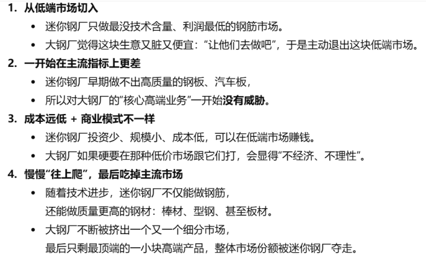

# Theme 1: Disruptive Innovation（颠覆性创新）

[← 返回主题目录](../README.md)

---

Christensen主要认为传统企业的失败主要是因为他们的成功逻辑让他们无法适应新的变化，他们一直在进行持续性创新，而不尝试着颠覆性创新。然而，Lepore指出企业衰退可能还受到经济、政治等外部因素影响，并批评该理论缺乏普遍性。Shaughnessy则认为克里斯坦森的理论仅适用于硬盘驱动器等特定快速变动行业，缺乏广泛适用性。

|                                      |                                                |                                                |
|--------------------------------------|------------------------------------------------|------------------------------------------------|
|                                      | 优势                 | 劣势                 |
| 持续性创新 | 拥有一定的用户基础   | 成本高               |
|                                      | 发展和收益稳定       | 很难改变商业模式     |
|                                      | 技术提升快           | 容易出现“创新者窘境” |
|                                      |                                                |                                                |
| 颠覆性创新 | 潜在市场大           | 初期盈利低           |
|                                      | 前期投入低（成本低） | 成功率低             |
|                                      | 商业模式灵活         | 需要时间培养市场     |

## 1. The Innovator's Dilemma （Clayton Christensen）
<!-- -->

1.  主要观点：

<!-- -->

1)  克里斯坦森将创新分为两大类：持续性创新和颠覆性创新。

    定义：

    持续性创新：这种创新是在现有技术的基础上进行改进，服务于现有市场的主流客户。

    EX：汽车行业中逐步改进发动机性能的技术。

    颠覆性创新：这种创新往往以较低的成本、简单的技术进入市场，最初吸引的是主流市场以外的边缘客户，之后不断改进，最终把原来的主流产品和领先公司挤下去。

    

    EX：DEC曾是全球领先的迷你计算机厂商，但因为认为性能低，利润低的个人电脑没有前景而拒绝投入。随着PC技术快速成熟，DEC最终走向衰落。

    EX：较小容量的硬盘最初被主流厂商（Seagate）忽视（利润太低且主流顾客要大容量的），但新兴企业（Conner）借此进入市场，逐步发展成主流。

    EX: 丰田公司（Toyota）通过引入小型经济型汽车，满足了对价格敏感的消费者需求，随后逐步进入高端市场，成功挑战了美国三大汽车制造商。

    EX：沃尔玛（Walmart）以农村市场为切入点，提供低价商品，逐步扩展到城市市场，颠覆了传统零售业态。

    

3)  颠覆性创新理论（就是创新者的窘境）：新兴企业可以通过颠覆性创新击败传统企业。（为什么优秀的传统企业会失败）

    原因：传统企业的成功逻辑跟不上新变化（仅仅关注持续性创新）。

    解释：（简单来说，就是大公司追求稳定，想赚肯定能赚到的钱；规模大的公司有自己复杂的流程所以难转型；并且看不上低端市场）

- 过度关注现有客户：以现有客户的需求为首要目标，忽视新兴市场的小众需求。

- 组织惯性：大公司的流程和规则都太复杂，总是优先维护原有赚钱业务，所以很难迅速转向新技术或新市场。

- 短期利益优先：企业倾向于追求短期利润，投资于高回报的持续性创新。

- 忽视低端市场：颠覆性技术往往从低端市场或小众市场切入，但这些市场通常被主流企业认为不值得关注。

2.  解决方案：（这个解决方案其实就是如何让传统企业进行颠覆性创新）

- 长远视角：将资源分配向潜在的未来市场，而不仅是现有市场的高回报领域。

- 设立独立单元：创立小团队专注于颠覆性技术的发展，避免受主流业务的束缚。

- 进入新兴市场：尽早关注和探索低端市场，抢占颠覆性技术发展的机会。

- 改变企业文化：鼓励风险和实验。

3.  现实意义：

- 对于传统企业来说必须制定战略，既要识别和培育颠覆性创新，也要持续进行持续性创新，以免被淘汰（颠覆性创新和持续性创新保持平衡）。初创企业来说，应该利用灵活和小规模市场作为优势进行创新，并最终挑战现有行业。

## 2. Disruptive Technologies: Catching the Wave (Joseph. Bower and Clayton.Christensen) Harvard Business Review
<!-- -->

1.  主要观点：企业失败的原因主要在于资源分配的权力结构，企业的资源分配高层常常占有很大的话语权，会优先将资源分配给主流客户。组织文化也有问题，没有奖励机制。

2.  解决方案：

- 管理者多观察新的技术。去多留意一些颠覆性技术，避免错过下一波浪潮。

- 执行新技术之前，确定技术是颠覆性的还是持续性的。

- 找到颠覆性技术的初始市场。让初创企业来进行试验，为大公司的成功做铺垫。

- 让独立的组织进行实验。

## 3. Clayton Christensen on disruptive innovation Clarendon Lectures (Christensen开的讲座)
<!-- -->

1.  观点：为什么一些国家或公司会停滞不前，而另一些却能持续增长？答案就在于他们做了什么类型的创新。

2.  EX：Christensen用钢铁行业解释“创新者的窘境”：大钢厂为了追求更高利润 ，选择只做高端、高利润钢材。低端产品利润太少，他们主动放弃。迷你钢厂就从最便宜、最烂的钢材开始做。等技术变好了，他们一步一步吃掉整个市场。最后，大钢厂反而倒下了。

    EX：发达经济体的停滞： 克里斯坦森指出，美国、英国和日本等发达国家的经济增长放缓，部分原因在于企业过度关注持续性创新，忽视了颠覆性创新带来的新市场机会。

    EX：亚洲一些国家通过积极采用颠覆性创新，实现了快速经济增长。

    EX：墨西哥未能充分利用颠覆性创新，导致经济增长乏力。

3.  现实意义：颠覆性创新不只是技术突破，更重要的是用新的商业方式，把产品做得更便宜、让更多人用得起。这样不仅能创造新工作机会，还能推动经济发展。

<!-- -->

## 4. The Disruption Machine: What the Gospel of Innovation Gets Wrong (Jill Lepore)
<!-- -->

1.  观点：Lepore对Christensen的观点是完全的否定。

2.  批判：

<!-- -->

1)  案例选择的偏差：克里斯坦森在其研究中选择的案例存在选择性偏差，会倾向于选择对自己研究有利的案例。

    EX: Christensen称传统大钢厂被“迷你钢厂”技术所颠覆。但是Christensen 没有提到在 1986 到 1987 年期间，传统大钢厂有两万二千名工人因劳工抗议而停工未上班。也会让大钢厂看起来更脆弱，更容易被竞争者赶上。

2)  对成功的定义有误：在颠覆性创新理论中，作者把那些在1977年至1989年间任意一年营收超过五千万美元的公司都归为“成功公司”，即使这些公司后来已经退出市场。

3)  理论的普适性较差：对于一些公共行业，比如说教育等就不能用创新性颠覆理论。因为这些行业追求的是稳定。

4)  理论的预测能力较弱：Christensen曾经预测iPhone和Netflix会失败，但是目前来看都很成功。

5)  对历史案件分析过于简单化，没有考虑到社会，经济，政治等因素。

<!-- -->

## 5. How Incumbents Survive and Thrive Birkinshaw
**其实可以作为对Christensen观点的反对，因为Christensen的颠覆性创新理论认为新兴企业可以通过颠覆性创新去击败传统企业，但在这里，颠覆并不严重。**

<!-- -->

1.  观点：数字化带来的颠覆没有想象中那么严重，老牌企业比大家以为的更有韧性，能够通过适应和转型继续生存和发展。

    数字化颠覆：利用数字技术（互联网、软件、数据、平台、云计算等）彻底改变传统产品、服务或商业模式的方式。Uber, Netflix, applepay都算是。

2.  解释：为什么数字化带来的颠覆没有想象中那么严重

<!-- -->

1)  比较了1995年和2020年的财富500强和全球500强榜单，发现老牌公司的占比依旧很高。

2)  传统行业能力被低估：Walmart在亚马逊崛起的背景下，通过开发电子商务成功保持了零售市场的主导地位。

3)  颠覆性创新的实际影响被夸大：大部分传统企业还是能保持市场份额；颠覆性创新企业难以实现长期的成功。

4)  对于市场变化，传统企业在努力适应：辉瑞通过内部创新成功保持市场地位。

5)  误认为颠覆性创新发生的速度很快且加速：1980年生物技术就被视为颠覆性产品，到2010年，它生产出的药物才成为重磅炸弹。

6)  传统企业应对颠覆的4种方式

- Fight back: 现有企业可以通过设立新部门、进行收购等方式来与颠覆者正面交锋。

  EX: British Airways推出低成本航班Go，就是为了正面应对低价航空的竞争。

- Double down: 老牌公司发挥自己的现有优势。

  EX：迪士尼本可以尝试在新兴且不确定的流媒体市场中竞争，但它却利用其在电影制作方面久经考验的优势。

- Retrench: 老牌公司自己主动收缩业务以降低风险和成本。

  EX：Kodak 关闭了很多胶片工厂，缩减传统胶片业务，集中资源做数码业务。

- Move away: 放弃原来的机会，去寻找新的机会。

3.  现实意义：颠覆性行业要学会与传统行业共存。并且颠覆性汉沽额要专注于如何实现长期的成功，传统行业要专注于如何转型和创新。

<!-- -->

## 6. What Did The Innovator's Dilemma Get Wrong? (Shaughnessy)
A: 观点：企业为什么失败为什么成功不存在真正的理论。他引用了Klepper所提出的一个解释：企业的衰落往往源自收购后扼杀创新，或者内部治理有问题。

<!-- -->

1)  对Christensen的评论：基于硬盘行业的研究，适用性不广。

2)  对Lepore的评论：赞成Lepore说Christensen的研究理论案件选择存在偏差且理论预测能力有限。

3)  对Christensen的颠覆性创新理论不是全部否定，Shaughnessy认为其理论在某些 行业还是有研究的价值的。

4)  并不存在真正的企业成功理论——企业需要做成千上万的决策，而最终起决定作用的变量往往是复杂且难以掌控的。

    **Carlota Perez**

    **Technological revolutions and financial capital : the dynamics of bubbles and golden ages**

<!-- -->

1.  研究技术革命的周期性模式及其对经济和社会的影响。

2.  信息与通信技术（ICT）革命的进程，并预测下一次技术革命的到来时间。

- 技术革命（主要分为安装期：引入和早期发展和部署期：广泛应用）

  Installation period和Deployment period

  部署期中期会孕育下一次革命的萌芽

- 技术革命的周期性模式：

  installation: 新技术的引入，引发创新和投资热潮，可能导致金融泡沫。

  Turning Point： 市场调整，重新评估技术价值。

  Deployment： 技术广泛应用，带来经济增长和社会变革。

  Maturity： 技术进步放缓，为下一次革命铺平道路。

## 7. Digital Transformation: Interview with David Edgerton (David Edgerton) talking about The Shock of the Old David Edgerton
观点：Edgerton指出很多新的创新对人们日常生活影响有限，旧技术也很重要不要忽视。传统的技术史往往过度关注创新和发明，而忽视了技术的实际使用和维护。

- 他强调，许多被视为“过时”的技术在全球范围内仍然广泛应用，对社会和经济产生深远影响。（旧技术还是有价值的）

  EX: 例如，尽管汽车和飞机等新技术的出现，马匹在20世纪的大部分时间里仍然是重要的交通工具。

<!-- -->

- 埃杰顿强调，技术的维护和修理在其生命周期中扮演着关键角色。

- 旧技术与新技术共存，许多被视为过时的技术在全球范围内仍然发挥着重要作用。

- 在现实中最火热的新技术，往往并不是人们日常生活中最重要的技术。而那些被忽视、看似“旧”的技术，反而真正支撑着社会的运转。

  案例分析：

<!-- -->

- 第二次世界大战中的技术： 埃杰顿指出，尽管V-2火箭和原子弹等新技术引人注目，但传统技术如马匹运输在战争中仍然至关重要。

- 纸张的持续使用： 尽管早在1975年就预测了“无纸化办公”，但全球纸张消费在过去三十年中翻了三倍，显示出旧技术的持续影响。

---

[返回首页](../README.md) · [Theme 2 →](../Theme2/README.md)
