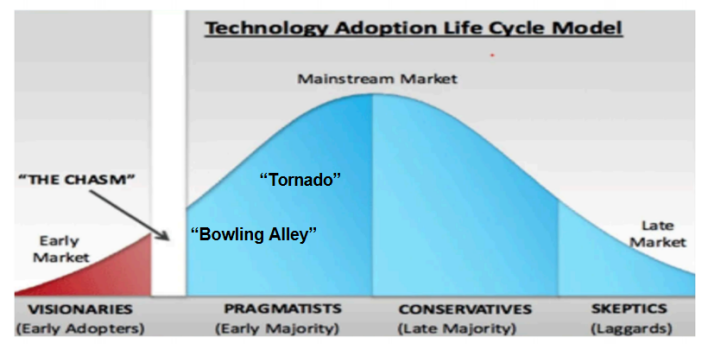
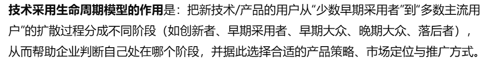
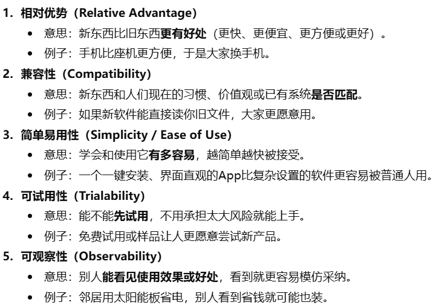
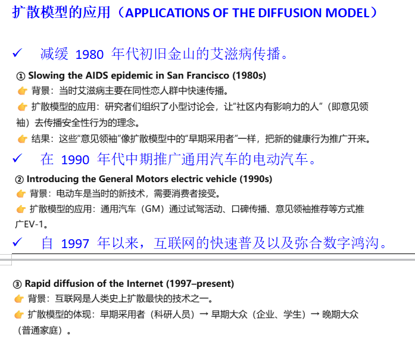

# Theme 2: Beyond Innovation

[← 返回主题目录](../README.md)

---

说明提出创新想法后，下一步该怎么做？在本专题中，我们将探讨创新想法提出后的发展过程。在本专题中，我们将探讨杰弗里-摩尔（Geoffrey Moore）广为人知的 "跨越鸿沟 "工作；我们将研究摩尔 "鸿沟 "的学术根源，即埃弗里特-罗杰斯（Everett Rogers）关于创新扩散的经典开创性工作；我们还将介绍达特茅斯商学院教授维贾伊-戈林达拉詹（Vijay Gorindarajan）关于创新执行的工作。

！！！STEP 1: 在提出创新想法后的第一步需要进行创新的执行！！！

## 1. The Other Side of Innovation: Solving the Execution Challenge (Vijay Govindarajan)
<!-- -->

1.  观点：

<!-- -->

1)  一个企业想要实现创新并且取得成功，关键不仅在于产生新的创意，更在于如何将这些创意高效而有效地执行。

    创新的定义：为世界创造一些新东西。

    EX：tataa Metro就是一个很好的例子。这家公司为印度创造出2000美元的汽车，这就是创新。他所做的事情就是让印度买不起汽车的穷人也能买的上汽车。

2)  创新难的原因：创新的逻辑与公司的主要赚钱逻辑不一样。创新是难预测的，而公司的主要赚钱逻辑是绩效引擎，即是通过重复和效率赚钱。所以一个组织不该以创新为企业文化。

3)  大企业能使用skunk works的方式进行创新嘛？不能！Skunk works是指规模小，高度自主的快速创新。但是，大企业的创新虽然需要自治但是创新内容不能脱离核心业务，不然就没有优势了。

4)  想要成功地执行创新，需要进行一下步骤：

- 必须创建一个专门的团队，就像一家初创公司一样。（创建一个双重结构的组织，核心运营团队继续维持公司的日常业务，独立的创新团队专注于探索新机会。）

- 专门的团队是独立的，但是不是孤立的，应该与核心业务挂钩。

- 应该有专门的团队去评估他们的绩效，不是基于短期的财务结果，而是基于他们检验未来假设的能力。

- 需要有支持创新的企业文化。

- 需要特殊的计划与流程，而这些计划和流程应该与企业核心业务不同。计划中应该包含：明确的目标，资源该如何分配和时间框架。

- 管理创新与日常运营的关系：创新团队与公司的常规运营部门之间可能存在资源竞争和文化冲突。作者强调，需要有效地管理这种伙伴关系，以确保创新项目的顺利推进。

- 实验和学习：在执行过程中，企业应持续开展实验与学习，因为创新难以一次性成功，必须通过不断的试错与调整来完善方案。

  EX：(在创新后没有进行有效的执行而失败的案例)

  黑莓也知道智能手机要做触屏，要做应用生态。但他们内部混乱，决策拖延。最后失败。

  ！！！STEP2：在提出创新想法后的第二步需要跨越鸿沟！！！

## 2. Crossing the Chasm ( Geoffrey Moore)
<!-- -->

1.  观点：

<!-- -->

1)  Moore强调，在早期采用者和早期大众之间存在一个显著的“鸿沟”。

    鸿沟的定义：早期采用者寻求突破性优势，而早期大众则关注可靠性和实用性。由于两者的心态，动机和决策方式非常不同，所以企业在让产品从早期用户群体扩展到大众市场时，往往会遇到困难，这种困难就被称为“跨越鸿沟”的挑战。

    Moore的理论基于技术采用生命周期。但是！！！技术采用生命周期是Rogers提出的。将消费者分为五个类别：创新者，早期采用者，早期大众，晚期大众，落后者。

2)  如何跨越鸿沟：

- 专注于特定细分市场：选择一个利基市场，满足其特定需求，建立成功案例。

- 提供完整产品：确保产品解决方案全面，满足目标客户的所有需求。

- 建立可信度：通过早期采用者的成功案例和正面评价，增强早期大众的信心。

  EX：iPod

  一开始苹果并没有试图吸引所有消费者 ，而是专注于音乐爱好者和Mac用户。并且苹果不仅仅卖的是一个设备，而是提供了一个完整的音乐生态系统（解决了当时用户下载音乐麻烦，格式不兼容的问题）。通过成功的用户体验进行口碑宣传。

3)  如何在B2B市场中跨越鸿沟？依旧是3步和(2)方法一样。

    B2B市场是指一家公司把产品或服务卖给另一家公司，而不是直接卖给普通消费者。

4)  如何在B2C市场跨越鸿沟？

    在当下数字时代中，互联网是跨越鸿沟的加速器。

    数字化B2C关键成功因素是四个齿轮：

- Acquire（获取）：吸引新用户，增加下载量或注册量。

- Engage（参与）：让用户持续使用、互动，提高留存率。

- Monetize（变现 ）：从用户使用中获得收入（广告、订阅、购买等）。

- Enlist（传播）：让用户主动推广或分享产品（形成网络效应）。

  因此要确保四个齿轮的转速一样，如果有一个齿轮慢了，会限制整体的增长速度。

5)  生命周期模型是Rogers提出的，但是Moore重新诠释，并使其适用于高科技领域；提供了生动的比喻（鸿沟、保龄球道、龙卷风等），帮助从业者理解复杂市场动态。

    

    保龄球赛道阶段：在进入大众市场之前，聚焦一个细分市场，找出痛点问题，给出方案。

7)  Moore认为，在技术采用生命周期的不同阶段，企业必须改变战略。

|                                          |                                                            |
|------------------------------------------|------------------------------------------------------------|
| 早期采用者阶段 | 创新                             |
| Bowling        | 找到痛点解决问题                 |
| Tornado        | 靠大规模，稳定，供应链与交付能力 |
| Late Market    | 靠低价，细分服务                 |

2.  现实意义：让公司在高科技市场获取成功的战略指引，教这些企业如何跨越鸿沟，如何成功。

<!-- -->

## 3. Reviewed Work: Inside the Tornado: Marketing Strategies from Silicon Valley's Cutting Edge by Geoffrey A. Moore in Journal of Marketing (Debi Andrus 对 Geoffrey A. Moore评论)
<!-- -->

1.  评判：

    优点（Strengths）

- Moore 成功地将Rogers的理论重新诠释，并使其适用于高科技领域。

- 提供了生动的比喻（鸿沟、保龄球道、龙卷风等），帮助从业者理解复杂市场动态。

  缺点（Weaknesses）

- 缺乏实证依据：作者坦言书中无“记录化证据 ”，导致学术说服力不足，过于依赖个人经验。

- 理论单一：过度依赖技术采用生命周期模型，未结合其他营销框架。

- 未提供“阶段转换”的量化指标：企业难以判断何时从保龄球道进入龙卷风。

- 此套理论是基于产品本身是优异的，但是在现实中，很多企业无法跨越鸿沟的真正原因是因为产品的问题。但是Moore根本没有说到如何制造好的产品。

## 4. Diffusion of Innovations（创新扩散）Rogers
<!-- -->

1.  观点：创新的成功不仅取决于其内在价值，还取决于其传播方式和社会接受度。

    扩散：指一种创新通过特定的渠道，通过时间，传播的过程。

    扩散框架：用来分析一个新东西如何从少数人开始，被越来越多人接受并且传播开的一套框架。

<!-- -->

1)  Rogers发明了扩散框架和技术采用生命周期模型。

2)  技术采用生命周期模型将adopters分为5类：

- 创新者（Innovators）：热衷于尝试新技术的冒险者。

- 早期采用者（Early Adopters）：具有远见的用户，愿意承担风险以获得竞争优势。

- 早期大众（Early Majority）：谨慎的实用主义者，在采纳新技术前需要明确的证据。

- 晚期大众（Late Majority）：对变革持怀疑态度，但在多数人采用后会跟进。

- 落后者（Laggards）：抵制变革，直到别无选择才接受新技术。

  模型的作用：这个模型把用户进行分类，（让从业者更简单地去理解复杂的市场）帮助企业按阶段去做不同的事。

  

3)  扩散框架主要是4要素：

- 创新

- 传播渠道：意见领袖和社交网络在传播中是很重要的。

- 时间：从知道到尝试到采用，不同人有着不一样的时间（技术采用生命周期模型/采用者类别）

- 社会系统：罗杰斯分析了社会规范、同伴压力和领导者在创新扩散中的作用，指出社会结构如何促进或阻碍创新的传播。

  解释同一个创新，为什么有的扩散快，有的扩散慢：

  相对优势，兼容性，复杂度，可试用性，可观察性（能不能看见优势）

  

4)  创新扩散理论有着广泛的应用与重要性：农业教育医疗。

    （互联网的扩散是人类历史上最快的创新之一）

5)  创新扩散理论对制定有效的推广策略至关重要，如果企业发现创新产品无法扩散，可以根据模型比对，看问题在哪里。模型也可以帮助企业制定推广策略。

    EX：

    

---

[← Theme 1](../Theme1/README.md) · [返回首页](../README.md) · [Theme 3 →](../Theme3/README.md)
