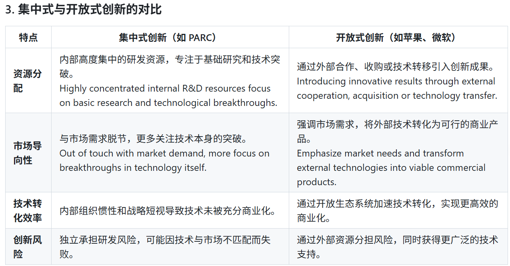
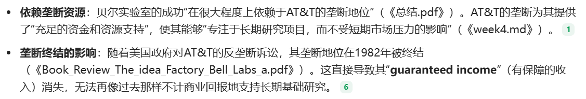
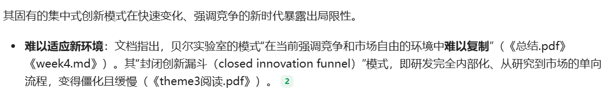
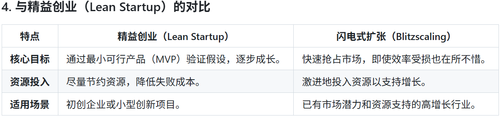
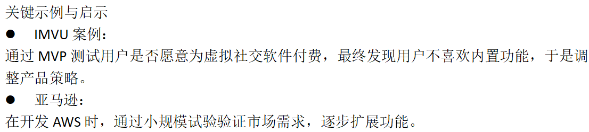
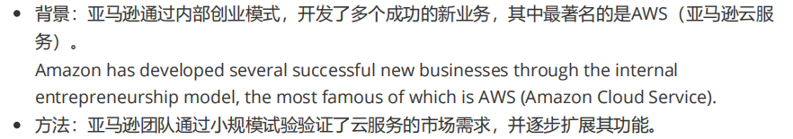
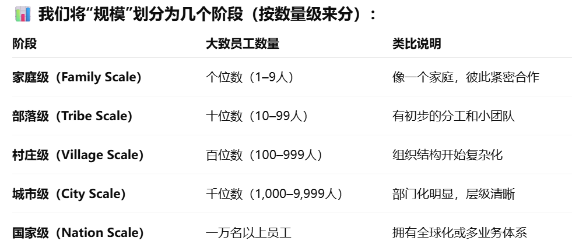
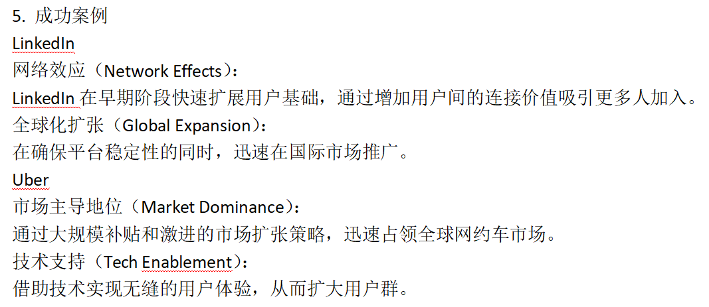

# Theme 3: Organizing and Financing Innovation

[← 返回主题目录](../README.md)

---

在本主题中，我们将探讨两个问题：

\(1\) 集中式研究实验室是否是企业促进创新的最佳方式？

\(2\) 如果你想进行创新，但需要资金来实现，这笔钱应来自哪里政府资助还是创业投资？

## 集中式创新

优势：（技术会有更大突破）

- 人才的集中，技术上会有更大的突破。

- 实验室提供着足够的研发资源，不宜商业化为目标，有助于技术的突破创新。

- 通过集中式创新，企业能够建立独特的核心竞争力，不易被竞争对手复制。

劣势：（组织惯性，风险大，商业化低）

- 内部会有组织惯性（公司已经习惯了原来的做事方式和赚钱模式，大家都不愿意去改变），会浪费技术上的优势。

- 技术没有充分商业化，导致收益较低。

- 可能因技术与市场不匹配，而浪费技术从而导致企业的失败。

- 独自承担研发风险。

## 开放式创新

优势：（风险低，商业化高，技术来源广）

- 通过外部资源分担风险。

- 有更广泛的技术支持。

- 通过开放生态系统加速技术转化，实现更高效的商业化。

劣势：（版权问题，思想挑战）

- 注意版权问题(企业通过开放式合作共享技术时，可能导致竞争对手获取关键优势)。

- 对于一些组织文化较为封闭的传统企业而言，接受和整合外部创新思想可能面临一定挑战。

- 核心竞争力的削弱，过度依赖外部创新，可能削弱企业内部研发的能力。

## 集中式创新：

定义：集中式创新指企业在内部研发部门中独立进行技术开发和创新。

## 1. The idea factory : Bell Labs and the great age of American innovation (Jon Gertner)
<!-- -->

1.  主要内容：

    EX：贝尔实验室（Bell Telephone Laboratories），创建了通信系统，使得世界上任何两个人在任何时间都能相互联络，发明了晶体管，推动了激光技术的发展。

    成功的关键点：

- 跨学科协作，鼓励物理学家，化学家等跨专业合作（人才的聚集）。

- 实验室为科学家提供基础支持，不追求功利，让他们摆脱商业限制，专注于长期的突破性创新（内部资源的支持）。

  失败的关键点：

  

  

  

  (在没有市场竞争压力下，它的资源分配是否合理，没有竞争的模式，是否还能促进创新？)

## 2. The Xerox Thieves: Steve Jobs & Bill Gates (短片)
<!-- -->

1.  EX：

    施乐公司的Xerox PARC实验室。创建了计算机鼠标、以太网网络以及（对我们的故事最重要的）图形用户界面（GUI）。

    PARC实验室结局：由于公司高层只关心于打印机的研究，对计算机毫不关心。最终实验室中的很多科学家都离开了PARC。

    成功的关键点：

- 人才高度集中，Xerox PARC汇聚了顶尖的科学家、工程师和研究人员，专注于前沿技术的探索。

- 创新不局限于市场，PARC 的研究重点在于探索未来的可能性，而不是短期商业化。

  集中式创新的局限性：

- 技术没有充分商业化，尽管 PARC 在技术研发上取得了巨大成就，但施乐公司未能成功将这些技术转化为商业产品（发明了好产品但是不会售卖，没有好的营销策略）。

- 公司内部组织惯性，公司已经习惯了原来的做事方式和赚钱模式，大家都不愿意去改变。所以即使PARC对计算机相关技术有了创新，公司依旧只想做于打印机相关事务（这一点更像是PARC这个实验室管理层的缺点）。

  这里可以和苹果公司和微软公司作比较（开放式创新）

  苹果和微软如何利用开放式创新：

- 吸收外部创新成果：苹果和微软从 PARC 的技术中获取了灵感，将 GUI、鼠标和网络技术整合到各自的产品中。

- 快速商业化：乔布斯亲自参观 PARC 并识别其技术的商业潜力，迅速将其转化为市场产品。微软通过研究这些技术并在自己的操作系统中应用，实现了大规模市场占有。

## 3. The HP Phenomenon : Innovation and Business Transformation (Charles H. House; Raymond L. Price)
**（内部创新和开放创新的好例子）**

<!-- -->

1.  核心内容：

<!-- -->

1)  惠普在其早期采取了高度集中化的创新模式：

- 专注于核心技术（如示波器等）的研发

- 投资于内部实验室，如开发激光打印技术

2)  HP集中式创新的局限性：

- 对外部市场需求反应迟缓：尽管惠普在打印技术等领域取得了突破，但其高度集中式的创新模式在面对快速变化的市场和颠覆性创新时表现较慢。（难察觉市场需求）

- 资源集中但灵活性不足：企业惯性导致阻碍创新尝试。（察觉了后转变难）

3)  HP逐步拥抱开放式创新：

- 兼并与合作：惠普在后期通过并购（如收购康柏）和外部合作拓展技术资源和市场。

4)  The HP way：HP更以其企业文化而出名。它的企业文化包括：利润分享，灵活的工作时间，相信每个员工的尊严与价值等。

- 企业文化对于企业的发展与创新模式的选择十分重要。

  一方面，HP 通过信任工程师、容忍试错和鼓励部门自治，形成了“员工驱动的内部创新”模式。创新不再只来自 HP Labs。

  另一方面，随着市场环境变化，HP 也逐渐意识到仅靠内部研发不足以支撑转型，开始更多地与外部企业、高校和合作伙伴联动，这才体现出典型的“开放式创新”，即主动向外部学习并利用外部创新资源。

  除此之外，HP也提供基础设施供HP Labs进行集中式创新。

  （HP通过优秀的企业文化，积极鼓励员工进行创新和内外部合作。优秀的企业文化对于企业成功发展十分重要。正是因为HP的企业文化帮助HP成功进行集中式和开放式创新）

5)  企业该如何选择集中式创新和开放式创新呢？

    还有一个要考虑的点就是企业所处的技术生命周期阶段

- 技术初期：集中式创新更有效。在技术刚起步或处于早期阶段时，集中式创新能提供更高效的资源利用和风险控制。

  例如，惠普的激光打印技术在研发早期完全依赖内部资源。

- 技术成熟期：开放式创新更灵活。当技术成熟且市场需求多样化时，开放式创新更有利于快速扩展应用领域。

  惠普在全球市场拓展时通过开放合作引入外部资源，实现规模化。

2.  现实意义：

    ！！！现代企业可以学习的地方！！！

    惠普的经验表明，企业需要在集中式创新和开放式创新之间找到动态平衡。

    惠普通过集中式创新为其提供了稳定的技术支持，实现了核心技术的突破，通过开放式创新。帮助他发展的更加多元化，适应市场变化。

    ————整理————

    在技术发展前期，可以进行集中式创新，因为技术还未成熟，进行集中式创新可以减少风险，并且可以专心攻克技术，确保能够拥有核心技术，确保企业在市场的地位。在技术发展的中期或者后期，可以进行集中式创新和开放式创新相结合的方式。通过开放式创新确保足够了解市场的需求。并且通过合作的方式可以完善技术，将技术使用情景能够更加多元化。此时的集中式创新依旧被需要，可以用于专心攻克下一个技术难题，确保企业一直处于前沿位置。

<!-- -->

## 4. Apple Co-Founder 'Strongly Influenced' by the HP of Yesterday(视频)
苹果公司联合创始人史蒂夫·沃兹尼亚克（Steve Wozniak）回顾他在惠普公司工作时期的经历。他认为HP是一个有着人文关怀，对社会有责任感的公司。HP允许任何人可以和任何级别的人沟通，并且零件库也不给工程师上锁随便用。把员工视作为家人。除此之外在经济衰退的时候，不得不裁员10%，但是他没有选择裁员，而是给每个员工降薪10%。

## 5. Open Innovation — A New Model for Industrial Innovation (Henry Chesbrough)
<!-- -->

1.  开放式创新：

    定义：**Chesbrough**将开放式创新定义为企业在创新过程中，不仅依赖内部资源，还积极利用外部知识和技术，同时将自身未充分利用的内部创新输出给外部组织，以实现价值最大化。

    开放式创新的特点：

- 外部知识的引入：企业应认识到并非所有聪明人才都在内部工作，因此需要与外部专家、学术机构和其他公司合作，引入外部创新成果，进行收购。

- 内部知识的外部化：对于未被内部充分利用的创新，企业应考虑将其授权、出售或通过其他方式与外部组织共享，以创造新的收入来源。

- 商业模式的重要性：成功的开放式创新依赖于有效的商业模式，将内部和外部的创新成果转化为市场价值。

  开放式创新的实践案例：

  亚马逊（Amazon）：通过开放其平台，允许第三方卖家入驻，丰富了产品种类，提升了客户体验。同时，亚马逊将其内部的IT基础设施发展为云计算服务（Amazon Web Services），向外部企业提供服务，创造了新的收入来源。

  开放式创新的挑战：

- 文化障碍：传统企业文化可能抵制外部想法的引入，导致创新过程中的内部阻力。

- 知识产权管理：在开放式创新中，如何保护和管理知识产权是一个复杂的问题，需要平衡开放与保护之间的关系。

- 组织结构调整：企业需要调整内部结构，以促进跨部门协作和与外部伙伴的互动，这可能涉及流程和管理方式的变革。

## 6. Exploring open innovation in the digital age: A maturity model and future research directions (Ellen Enkel; Marcel Bogers; Henry Chesbrough)
<!-- -->

1.  主要观点：

<!-- -->

1)  数字时代改变了创新方式：过去创新主要靠公司内部。现在因为互联网、大数据等技术，知识在组织之间流动得更快。企业必须开放，与外部合作，才能跟上时代。

    （由于互联网，大数据的发展使得知识传播更加简单，因此公司不能只靠内部创新，还应该开放与别人合作才能跟上时代）

2)  作者提出一个“开放式创新成熟度模型”

    企业分为 3 个阶段：

Traditionalist（传统主义者）

<!-- -->

- 不愿意对外开放

- 认为“外部的东西不如我们自己做的好”

- 合作很少

  → 开放式创新几乎没有做

<!-- -->

Modernist（现代主义者）

<!-- -->

- 开始愿意向外学习

- 会与客户、供应商、科研机构合作

- 后期甚至把开放式创新推广到各个部门

  → 开放式创新已成为常规做法

<!-- -->

Visionary（领先者）

<!-- -->

- 把开放式创新当成战略武器

- 主动构建创新生态系统（例如平台业务）

- 与许多跨行业伙伴合作

- 有强大的动态能力、能快速适应变化

  → 企业成为生态系统的“领头者”

## Financing Innovation 创新融资

（国家和企业在创新融资中不应该是对立的，应该是相互帮助，一起协作）

探讨创新的资金来源以及去向

“谁应该为创新出资并承担风险，以及谁应获得回报”

创新可以被描述为一个过程：为有了创意就对这个创意投资，然后获得回报。

## 1. Look at the phone in your hand – you can thank the state for that \| Rutger Bregman
## 2. Government -- investor, risk-taker, innovator(Mazzucato的ted演讲 蓝色)
Rutger Bregman在2017年7月发表于《卫报》的一篇文章中，阐述了Mariana Mazzucato在其著作《创业型国家》（The Entrepreneurial State）中的核心观点。

<!-- -->

1.  核心观点：

    **Mazzucato的观点:**

- 尽管私人企业常被视为创新的主要驱动力，但实际上，许多颠覆性技术的基础源自政府的投资和支持。

- Mazzucato强调，政府不仅仅是市场的监管者或修正者，还应被视为积极的市场塑造者和风险承担者。(与传统观点不一样：即政府应仅限于纠正市场失灵)

- Mazzucato呼吁重新审视政府与私营部门之间的关系，主张政府应在创新生态系统中扮演更积极的角色，而不仅仅是为私营部门创造有利条件。

  之前很多人认为企业是对创新的最重要的，但是MAZZUCATO认为政府对创新重要。很多企业一开始是靠政府的资金存活的，许多创新都是靠政府投资和支持。但是政府获得的利润少。

  在未来政府不但是市场的监督者和修正者，还应该是承担风险者和塑造者

  EX：我们熟知的“硅谷创新天堂”一开始其实是靠政府资金支撑起来的。

  在20世纪50–70年代，美国政府投入巨额科研经费，支持半导体、计算机、互联网等基础技术的发展——这些正是硅谷崛起的根基。

  EX：互联网，Siri，GPS最初都是由国防部等各个政府机构资助和开发的。

  (政府在早期阶段承担了高风险投资，资助了许多私人部门可能认为过于冒险的项目。这种公共投资为后来的私人企业创新奠定了基础。)

由国家推动发展的主要创新领域包括：

航空（Aviation），核能（Nuclear energy），计算机（Computers），互联网（the Internet），生物技术（Biotechnology），绿色科技（Green technology）

苹果iPad和iPhone所使用的12项核心技术中，有很多都源自国家科研项目的支持。

Mazzucato曾说过，在20世纪50–70年代，美国政府投入巨额科研经费支持半导体、计算机、互联网等基础技术的发展，因此早期的很多基础性研究由国家机构资助。

## 3. Some thoughts on The Entrepreneurial State (Stian Westlake对 Mariana Mazzucato 的《创业型国家》（The Entrepreneurial State）提出的批评)
- Westlake认为Mazzucato对创新观定义狭隘了，企业也对创新付出了很多。认为Mazzucato忽视了企业在将发明转化为可用产品时承担的巨大创新工作与风险。

  （过度关注技术，而忽视了发展性进步）

  EX: 以苹果为例，真正的创新不仅是创造这些技术，而在于如何将不同技术整合为一个可靠、便携的产品；以及如何改进性能与设计。

- Mazzucato认为政府创新的风险与收益分配严重不对称，认为大部分钱都被私企赚走了。但是，Stian Westlake觉得政府获得了税收的回报。并且私企用创新生产出来的产品让大众生活更便利、更幸福，这种“非经济回报”巨大。

- Mazzucato的建议：她提出，政府在资助高风险创新时，应要求获得更直接的经济回报（如股权或专利收入），以平衡公共资金的风险和收益。Westlake 的批评：他认为要求政府参与股权可能会导致效率低下的问题，因为政府并不总是具备像私营投资者那样的市场敏锐性。

  Westlake的观点：

- Westlake 并未完全否认政府的作用，而是主张政府应该更加灵活地支持创新生态系统，而非单纯充当主导者。他认为，创新的成功需要政府与私营部门之间的紧密合作，而不是简单地将二者对立起来。

- 国家的创新角色应是支持者与催化剂，而非利润分享者或投资人。

- Westlake 强调私营企业在创新的后期阶段（商业化）中的重要性，认为市场竞争是推动创新成果扩散的重要力量。

  mazzucato认为在创新中，政府不应该仅仅是监管者，修正者，提供机会的人还应该是创新的主导者。因为有很多科技的发展都是基于政府的支持。比如说像siri,gps等都是政府机构进行研发的。像早期的硅谷也是政府在提供资金支持。

  但是，westlake提出批评。他认为mazzucato对创新的理解过于单一。因为创新不仅仅是技术上的创新，将技术整合为一个商业化的产品，如何改进技术如何使技术多元化，如何设计产品这个也是创新。所以不能忽视企业对技术进行商业化时的风险。因此企业对于创新来说也是有很大贡献的。第二，对于Mazzucato认为政府的付出和最后的收入不匹配，大部分钱都被企业赚走了，Westlake认为企业已经进行交税了，并且企业创造的产品带给人们的非经济的价值也是不可忽视的。这些产品让人们的生活更加便捷。第三，Mazzucato认为应该政府应该拥有着更直接的经济回报，比如说股份等。Westlake认为这个一点是很难实现的。因为首先一个技术很多时候是有很多企业共同合作，很难去计算政府应该占多少股份。并且政府的市场敏锐度较低，因此可能会导致企业的效率低下，不有利于创新发展。第四，Westlake认为Mazzucato过于理想化，并不是所有以政府为领导的创新都可以成功。有的创新比如说是癌症战争就失败了。真正健康的创新应该基于多元化，而不是又一个为主导的。

  那么我认为，政府和私企应该是在不同阶段互相帮助。政府应该进行0-1的突破，而企业应该进行1-N的发展。就像美国国家卫生研究院NIH资助了生物技术的基础研究，而药物的开发和如何商业化是由各个企业进行发展的。政府应该给企业们建立良好的创新环境，鼓励创新鼓励竞争，这样技术才会得到更快更好地发展。

## 4. "The Art of The Start 2.0" by Guy Kawasaki - VIDEO BOOK SUMMARY
在这本书中，Kawasaki分享了他的实战经历以便更好地帮助企业家去创业。

书中有四个突出的重点部分：

<!-- -->

1)  创业初期不要想太多，不要太早去追求规模化。找到一种有意义的产品更为重要。

2)  给产品讲故事才有吸引力。作为一个企业家，我们必须推销一种不同的未来愿景这样才能有吸引力。

3)  寻找有才华但没有受到束缚的人

4)  好的宣传很重要，要解释的很简单，吸引观众的注意力。为你的观众提供他们所需要的故事，以便他们梦想更美好的未来。

   

<!-- -->

## 5. Conversations: What Large Companies Can Learn from Start-ups: An Interview with Eric Ries in Research Technology《大型公司能从初创企业学到什么》\[!!!\]
## 6. The Lean Startup
Eric Ries和Jim Euchner 探讨《The Lean Startup》

Eric 是 The Lean Startup的作者

<!-- -->

1.  核心思想：

<!-- -->

1)  “精益创业”是Eric提出的：所要做的，就是把这些企业家、风投和经理人在创新中积累的最佳实践与直觉经验，加入更系统、更严谨的验证方法。在极度不确定的环境下，用最小的成本、最快的速度，验证你的商业想法是否正确。

2)  最小可行产品（MVP）：MVP 是一种策略，通过开发最基础的产品版本以验证假设，获取市场反馈，从而避免资源浪费。

3)  目标：以最小的投入迅速测试市场需求，确定产品方向。

4)  创新会计（Innovation Accounting）：因为在创新的产品中，收入是无法预计的。因此，我们需要一种新的衡量体系。它专门用于那些预测不可靠的创新情境，帮助我们识别：谁真正通过实验和学习推动了进展，而不仅仅是表面上的数字好看。（阶段性评估）

5)  精业创业的整个循环过程：

    构建：开发基于假设的产品或服务。

    测量：收集用户反馈，评估假设的准确性。

    学习：根据反馈调整产品，迭代优化。

6)  局限性：

- 适用范围的局限，精益创业方法适合高不确定性环境，但在高度成熟和稳定的市场中，其适用性可能较低。

- 与传统流程的冲突，在大型企业中，精益创业方法可能与传统的层级管理和KPI目标冲突，需要特别设计以兼容两者。

- 文化接受度，对于习惯了固定流程和明确计划的员工和管理者来说，精益创业方法需要一段时间才能被完全接受。

7)  转型：若创业者在假设被验证为无效后应该转型。有两种类型的转型，一是产品转型（更改核心产品功能），二是市场转型（调整目标市场或用户群体）。

8)  精业创业在大型企业中的应用，在企业内部建立“小型创业团队”，赋予其类似初创公司的自由度。实施“创新实验室”，专注于快速试验和探索新产品。

<!-- -->

2.  EX:

     
     
     

<!-- -->

## 7. Blitzscaling in Harvard business review
这段关于 Reid Hoffman（LinkedIn 创始人）谈“闪电式扩张（Blitzscaling）” 的文章。

Blitzscaling是Reid Hoffman提出的。

<!-- -->

1.  概念：

    Blitzscaling（闪电式扩张）它的核心目标是以速度优先，通过迅速扩大用户规模和市场占有率，在竞争对手反应之前建立先发优势和市场主导地位（Market Dominance）。

<!-- -->

1)  适用于：已经验证产品市场契合、并且存在强网络效应（Network Effects）的行业，如软件、社交媒体或平台经济等。软件产业天生适合“闪电式扩张”，因为它在服务更大市场时的边际成本几乎为零。（边际成本是指每增加一个新客户或生产一个新单位产品所需要增加的成本。）

2)  核心目标：优先速度（Speed over Efficiency），在扩张初期，企业需要快速占领市场，即便可能会带来资源浪费或组织混乱。

3)  容忍混乱（Tolerance for Chaos）：扩张过程中不可避免地会出现结构性混乱或管理问题，但这些问题是快速增长的必要代价。

4)  那创业公司什么时候会开始“闪电式扩张”呢？

    

    一般来说，“闪电式扩张”会在部落级与村庄级之间启动。到了这个阶段：你已经找到了产品–市场匹配；你掌握了一定的数据；你对竞争格局也有了清晰认识。

    

    扩张之后需要干什么？

    随着公司不断成长，各层级的专业化（specialization） 变得愈发重要。要建立完善的数据仪表盘（dashboards）、分析系统（analytics） 和绩效指标（metrics）。

    并且随着规模扩大，可靠性比灵活性更重要。除此之外，当企业变大之后会从“单线程组织”变成到“多线程组织”，不会但一研究一个项目会尝试一些副项目。

6)  EX:

    

---

[← Theme 2](../Theme2/README.md) · [返回首页](../README.md) · [Theme 4 →](../Theme4/README.md)
