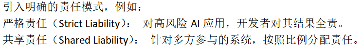
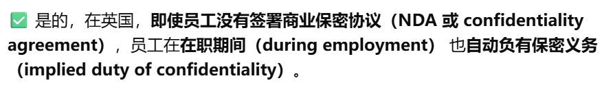
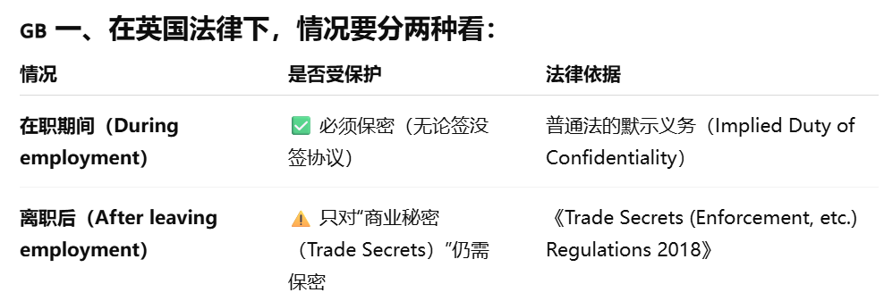
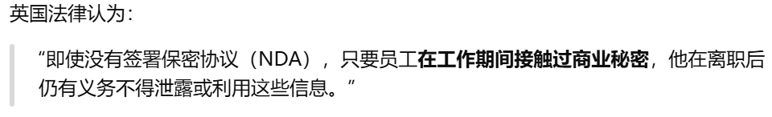
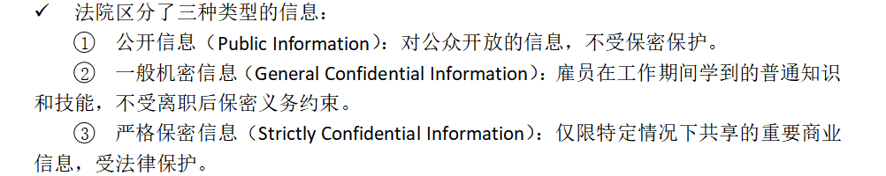
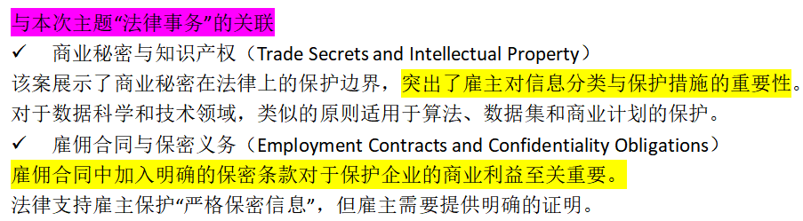
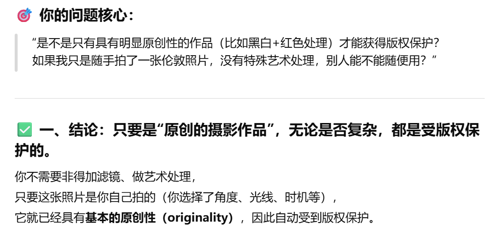
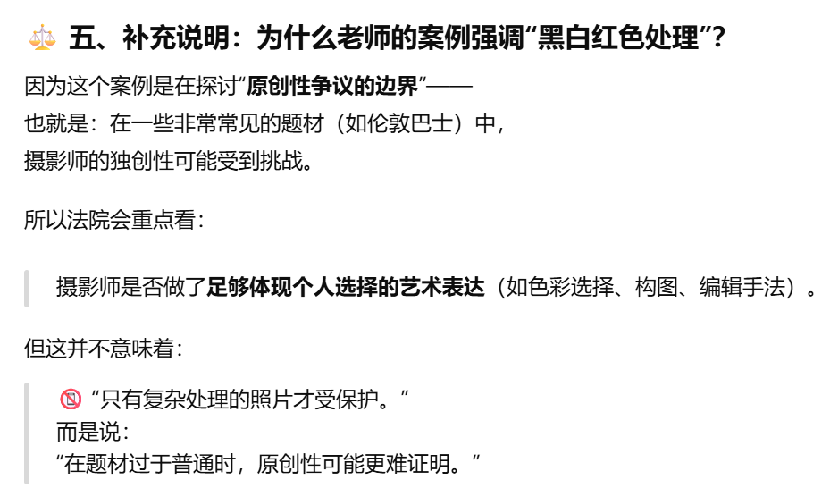
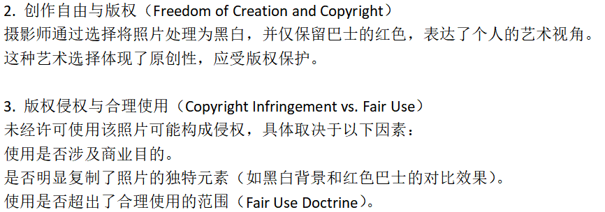

# Theme 4: Legal Matters

[← 返回主题目录](../README.md)

---

**我们将探讨知识产权（专利、版权、商业秘密和开源）**

**我们将讨论对全球数据保护立法的制定具有深远影响的欧盟《通用数据保护条例》（GDPR）**

**我们还将探讨当前对欧盟委员会《人工智能法案》的看法。**

&nbsp;
&nbsp;

IPO: 是英国知识产权局，负责管理和保护知识产权权益

IP的定义：知识产权是通过法律去赋予人们对他们自己的成功的独有权。

**IP可以被分成四个部分Patents，Trade Secrets，Copyright版权和Trademarks。**

**Patents 专利保护发明本身（功能和原理）**

定义：专利是一种法律保护，授予发明人对其发明的独占权，通常为期20年。

申请流程：提交申请，包括详细的发明说明和权利要求。经过形式审查和实质审查，确保符合新颖性、创造性和工业适用性。

申请费用：专利申请过程复杂且费用昂贵，包括律师费和国际专利注册费用。

专利权利：专利持有人有权阻止他人在未经许可的情况下制造、使用、销售或进口受专利保护的发明。

公开技术：专利申请要求公开技术细节，可能会被竞争对手逆向工程。

当你申请专利时，政府会给你一段时间的独占权（通常20年），但作为交换，你必须公开你的发明的技术细节。也就是说：你可以独占使用你的发明，但你必须告诉全世界它是怎么实现的。这样做的目的是让社会整体能学习你的创新，促进科技发展，而不是永远把知识藏起来。

问题在这儿：当你申请专利、公开技术细节后，虽然短期内有法律保护，但长期来看，竞争对手可能会通过阅读专利信息去学习、模仿、甚至改进你的技术。

- 优势：

  法律保护力度强：专利能够提供明确的法律保护，阻止其他公司未经许可复制或使用技术。

  市场竞争力提升：专利可以增强公司在市场中的地位，并提高吸引投资者的能力。

  收入来源多样化：专利可以通过许可或出售产生额外收益。

- 劣势：

  申请成本高昂：专利申请需要支付高额费用，包括律师费和国际专利注册费用。

  公开技术细节：专利申请要求公开技术细节，可能被竞争对手逆向工程。

  时间消耗较长：专利申请过程可能需要数年时间，可能拖延产品的上市。

**Copyright 版权保护艺术，音乐，代码等原创作品，自动生效，无需申请。**

- 优势：

自动保护：一旦作品完成，版权即生效，无需额外手续。

保护期限较长：版权的保护期限为作者寿命加70年，适合长期使用。

成本低：版权保护不需要复杂的注册流程，成本较低。

- 劣势：

保护范围有限：版权仅保护表达形式，而不保护技术功能。

执行难度较高：版权侵权的取证和执行可能较为复杂，尤其在国际范围内。

**开源许可（Open Source Licensing）**

定义： 开源许可是一种特殊的版权行为，公司可以选择将技术公开，允许其他开发者和公司在遵守特定的条件下，使用、修改或分发。

- 优势：

品牌建设： 开源展示了公司的透明度和技术实力，有助于提升声誉。

合作机会： 开源许可可以促进行业标准的形成，吸引潜在合作伙伴。

- 劣势：

盈利模式受限： 开源可能限制技术的直接商业价值。

难以控制用途： 技术一旦开源，公司无法完全控制其用途。

竞争风险： 竞争对手可能利用开源技术开发更具竞争力的产品。

**Trade Secrets ：商业秘密保护技术和方法等机密信息，前提是公司采取合理措施保持其保密性。**

有三个种类：

1. 公开信息 (Public Info): 随意使用。

2. 一般机密信息 (General Confidential Info/Know-how): 在职期间需保密，离职后不能限制使用（除非有竞业协议）。

3. 商业秘密 (Trade Secrets): 高度机密，离职后依然必须保密。

- 优势：

无需公开：与专利不同，商业秘密不需要公开技术细节。

保护期限无限：只要保密性得以维持，商业秘密的保护期限是无限的。

成本较低：保护商业秘密的主要成本是建立安全和管理机制。

- 劣势：

易受泄露风险： 如果信息被泄露或被竞争对手逆向工程，法律保护可能较弱。

难以在法律上执行： 商业秘密的侵权案件通常较难取证和界定。

**商标 (Trademarks)**

定义: 保护品牌标识（名称、Logo、口号等），用于区分商品来源，防止消费者混淆

&nbsp;
&nbsp;

**策略建议**

根据公司的技术特点和市场需求，建议采用组合式知识产权保护策略：

- 关键技术申请专利保护：

对核心创新申请专利，确保市场独占性和法律保护。

- 辅助技术使用商业秘密管理：

对不适合专利化的内容采用商业秘密保护，降低成本并确保灵活性。

- 部分代码或文档版权保护：

利用版权保护技术表达形式，同时附加适当的使用条款。

- 非核心技术考虑开源：

对非核心技术采用开源许可，扩大市场影响力，吸引社区合作。

&nbsp;

专利的一个例子是搜索引擎：pagerank

这是google特有的一种搜索引擎。与传统的按照相关词进行搜索不同，pagerank它是按照网页重要性排序。Pagerank的基本想法是，如果一个网页链接了很多网页，那就说明这个网页是较为重要的，因此在搜索时会优先推荐。

由于独创性，PageRank的精准排名机制推动了互联网广告（如 Google Ads）的繁荣，奠定了 Google 的盈利模式。

PageRank能够做成专利的主要特点（Key Features of the Patent）

新颖性（Novelty），实用性（Utility），可扩展性（Scalability）

专利对其技术进行了保护，有效期为20年。保护的技术包括：基于链接分析计算节点排名的方法。使用该方法的计算系统和架构。

&nbsp;

**公有领域 Definition of Public Domain**

公有领域的定义：指那些不再受知识产权保护的作品或从未受保护的作品。

作品进入公有领域的原因：版权到期（Expiration of Copyright），未注册或未续展（Failure to Renew or Register），公共创作（Created for Public Use）

公有领域的重要性（Importance of the Public Domain）：

- 促进创新与创作（Fosters Innovation and Creativity）：

公有领域为创作者提供灵感和资源，允许对原始作品进行自由改编和使用。

- 扩大知识共享（Enhances Knowledge Sharing）：

公有领域的作品可以被教育机构、研究人员和公众广泛使用，推动知识传播。

- 数据科学与AI的意义

公有领域作品可以为数据科学和人工智能提供训练数据，而无需担心法律问题。例如，使用公有领域的文学作品进行自然语言处理（NLP）模型的开发。

&nbsp;

**Creative Commons知识共享**

定义：Creative Commons (CC) 是一套灵活的版权许可工具，允许创作者在保留部分版权的同时分享他们的作品。

目标：是为创作者和公众提供更多选择，推动知识共享和再创作。

使用 Creative Commons 的常见领域：教育（Education），艺术和文化（Arts and Culture），科学与研究（Science and Research）

- 相比传统版权，CC 提供了一种创新的方式，在保护创作者权利的同时推动知识共享。

- CC的使用方式：在Creative Commons官方网站上选择适合的许可协议，并标注在作品中。

## GDPR explained: How the new data protection act could change your life GDPR 解释：新的数据保护法将如何改变你的生活

  GDPR全称general data protection regulation 数据保护条例。

  GDPR的目标：

<!-- -->

- 保护数据主体的权利（Protect Data Subject Rights）：赋予个人对其数据的更大控制权。

- 统一数据保护法律（Harmonize Data Protection Laws）：在整个欧盟内实现统一规则。

- 促进责任制和透明度（Promote Accountability and Transparency）：要求组织采取更多的责任措施来保护数据。
  
&nbsp;

核心原则（Core Principles）所有处理个人数据的组织（公司、学校、政府部门等）在处理数据时必须遵守的基本原则。

- 数据最小化（Data Minimization）：只收集与目的相关的必要数据。

- 时间限制（Storage Limitation）：数据仅能保存必要时间。

- 合法性、公平性和透明性（Lawfulness, Fairness, Transparency）：数据处理必须透明并符合合法目的。

- 目的限制（Purpose Limitation）：数据仅能用于明确的目的。

- 准确性（Accuracy）：确保数据准确无误并及时更新。

- 完整性与保密性（Integrity and Confidentiality）：确保数据安全。

- 问责制（Accountability）：组织必须遵守规则。

&nbsp;

关键权利（Key Rights of Data Subjects）用户权利：

- 访问权（Right to Access）：个人可以请求访问其数据。

- 更正权（Right to Rectification）：要求修改不准确的数据。

- 反对权（Right to Object）：个人可以反对其数据用于某些用途，如直接营销。

- 删除权（Right to Erasure, “Right to Be Forgotten”）：在特定情况下要求删除数据。

- 数据可携权（Right to Data Portability）：数据主体可以将数据转移给其他服务提供商。

  

<table>
<colgroup>
<col style="width: 48%" />
<col style="width: 51%" />
</colgroup>
<tbody>
<tr class="odd">
<td><strong>GDPR（数字保护条例）</strong></td>
<td><strong>EU AI Act（欧盟人工智能法案）</strong></td>
</tr>
<tr class="even">
<td>General Data Protection Regulation</td>
<td>European Union Artificial Intelligence Act</td>
</tr>
<tr class="odd">
<td>
保护个人数据与隐私

（重点在于个人数据不能乱用、必须透明、安全可控）

<ul>
<li>
用户权利：
</li>
</ul>

知情权、访问权、更正权、删除权

拒绝数据处理 / 限制处理的权利

<ul>
<li>
企业必须做的：
</li>
</ul>

处理数据前必须获得明确同意（Consent）

数据泄露必须72小时内通知

数据必须加密、匿名化、减少采集（Data Minimization）
</td>
<td>
确保AI安全、可信、可控，不伤害社会或人

（重点在于按风险层级来管理AI系统）

<ul>
<li>
风险被分成（不可接受、高风险、有限风险、最低风险）
</li>
<li>
高风险为了治理合规需要做到：
</li>
</ul>

数据治理：确保数据质量无偏见。

透明性：系统必须记录决策过程，并提供解释性工具。

人类监督：特别是在医疗和执法领域，人工干预至关重要。
</td>
</tr>
</tbody>
</table>

## The EU’s AI Act, Explained \| WSJ Tech News Briefing

## 欧盟人工智能法案解读 \| 华尔街日报科技新闻简报

1)  EU AI Act颁布的目的：目前生成式AI的势头很猛，如果不进行管控可能会伤害人们。

<!-- -->

## 9. Decoding the EU Artificial Intelligence Act 解密欧盟人工智能法案 Daniel Zhang
(1)《欧盟人工智能法案》的背景与目标

- 背景：欧盟希望通过 AI Act 成为全球人工智能治理的领导者，同时确保技术安全性、透明性和伦理性。

<!-- -->

- 目标：

<!-- -->

- 保护公民隐私和基本权利。

- 防止高风险人工智能系统带来的潜在危害。

- 为开发者和用户提供明确的法律指导。

2)  法案的主要特征

- 风险分级体系

<!-- -->

- AI 系统被分为四类风险（不可接受、高风险、有限风险、最低风险）。

<!-- -->

- 高风险系统为了合规需要做什么（特定领域的AI，比如生物方面）

  高风险AI主要是用于安全类的，比如用于汽车、医疗。或者是特定领域的，比如说用于软件开发等。

<!-- -->

- 数据治理（Data Governance）：确保数据质量无偏见。

- 透明性（Transparency Requirements）：系统必须记录决策过程，并提供解释性工具。

- 人类监督（Human Oversight）：必须有人类介入关键决策。

<!-- -->

- 法案中提出了针对生成式AI系统有特殊规定：

<!-- -->

- 要求展示训练数据的来源。

- 防止生成非法内容。

- 标记AI生成的内容

3)  法案实施的挑战：

- 技术适配

<!-- -->

- 法案需要在快速变化的技术环境中保持适用性。需要建立灵活机制，定期更新高风险分类和合规要求。

<!-- -->

- 合规成本

<!-- -->

- 法案对中小企业（SMEs）可能不够友好：

- 高昂的合规成本可能导致中小型企业无法与大公司竞争。

- 建议制定激励措施，如为合规研发提供财政支持。

<!-- -->

- 国际竞争

<!-- -->

- 法案可能使欧盟企业在全球竞争中处于不利地位，尤其是与监管较松散的地区（如美国或亚洲）相比。

4)  全球影响力：

- 标杆作用：AI Act 被视为全球第一个全面的人工智能监管框架，可能对其他国家和地区起到示范作用。

- 保护数据主权:强调数据治理和隐私保护

5)  EU AI Act的核心在于以人为本，要确保伦理性（避免偏见和歧视），透明性和安全性。

## 7.European Parliament debates proposed law on AI regulation \| DW News《欧洲议会就人工智能监管法案展开辩论》

对于监管AI会导致扼杀创新，有什么看法？

监管AI不一定会扼杀创新，也有可能会激发创新。监管是为了让AI在安全中运行，在安全中创新。并且监管的方式也不是一定要一开始就把所有规则定死，是可以根据实际情况及时调整，这种方式既保证安全，也不会阻挡技术继续前进。

## 10.How the EU Can Achieve Legally Trustworthy AI: A Response to the European Commission’s Proposal for an Artificial Intelligence Act 欧盟如何实现合法可信的人工智能：对欧盟委员会《人工智能法》提案的回应 \[对AI ACT的改进\]（伯明翰大学法学院）

- 风险分级的改进

问题：当前的风险分级体系虽然全面，但部分定义过于模糊。

建议：

提供更具体的分类标准，特别是在高风险系统中，明确哪些应用需要严格监管。

增加动态更新机制，确保法案能跟随技术发展调整风险分类。

- 透明性与可解释性

问题：现行法案未充分说明如何实现算法透明性。

建议：

强制要求开发者提供详细的文档，解释模型决策的依据。

- 数据治理与公平性

问题：法案对数据治理的要求尚不完善。

建议：

加强对数据集的审核。要求开发者主动展示数据来源，减少歧视性偏见的风险。

- 责任分配与问责

问题：法案在责任分配上仍存在空白，特别是涉及多方合作的AI系统。

建议：

明确开发者、部署者和用户的法律责任。

- 国际协作与竞争力

问题： 法案可能使欧盟企业在国际市场中处于竞争劣势。

建议：推动国际标准的制定，确保全球协作，同时避免因监管壁垒导致的技术外流。

## 12a. Legal Updates, Trade Secrets: Vestergaard Frandsen vs Bestnet Europe Ltd

问题：在人工智能（AI）的法律应用中，责任分配（Responsibility Allocation）和算法透明性（Algorithmic Transparency）这两个关键概念仍然缺乏清晰定义。

责任分配：责任分配是指在人工智能系统作出决策或执行操作时，确定谁应承担法律责任。

算法透明性：算法透明性是指能够理解和解释人工智能系统如何作出决策。（法律上需要明确，透明性需要达到什么程度才足够合规。）

&nbsp;

可能的解决方法：

- 责任分配的法律标准，引入明确的责任模式：

严格责任（Strict Liability）： 对高风险AI应用，开发者对其结果全责。

共享责任（Shared Liability）： 针对多方参与的系统，按照比例分配责任。

- 推动算法透明性

要求AI开发者记录并披露关键决策流程。

推广可解释人工智能（Explainable AI, XAI）技术，在性能与透明性之间取得平衡。

- 多方协作治理

监管机构、开发者与法律专家合作，制定全球统一标准，解决责任和透明性的不确定性。

&nbsp;

**商业秘密的案例**

例子1

Fowler 在 Faccenda Chicken Ltd 工作期间，接触到关于公司客户名单、价格策略和分销路线等机密信息。

离职后，Fowler 开办了一家与 Faccenda Chicken Ltd 类似的业务，并使用了这些信息。

Faccenda Chicken Ltd 提起诉讼，声称 Fowler 违反了信任和保密义务。

法院判决结果为：客户名单和分销路线属于一般机密信息（General Confidential Information），但未达到“严格保密信息”的标准。Fowler没有违反法律上的保密义务。

例子2

Vestergaard Frandsen 是一家生产和销售防治疟疾蚊帐的公司，依靠高度敏感的研发信息来维持其市场竞争力。

Bestnet Europe 是一家公司，由 Vestergaard 的前雇员成立，涉嫌使用 Vestergaard 的商业秘密开发类似产品。

争议点在于，这些前雇员是否违反保密义务，非法使用了公司商业秘密。

法院判决：

仅仅有怀疑不够，必须有确凿证据。1. 这个员工确实接触过这些商业秘密 2. 或者他确实在之后使用了这些秘密信息。

本案件学到什么？

1.  雇主想要保护商业秘密应该知道加强合同条款的必要性：企业应在雇佣合同中明确约定保密义务及离职后的限制。

2.  应该理划定商业秘密的范围。这样既能够维持开放创新与秘密保护之间的平衡，也能够让员工明白哪些是属于商业机密，即使离职后也不能说。

    **案例：版权法如何适用于摄影作品的独特性保护**

某摄影师拍摄了一张以伦敦红色双层巴士为主题的黑白照片，照片中唯一保留了巴士的红色。

该作品因其视觉冲击力而受到广泛关注，但随后有人未经许可使用了这幅作品，摄影师因此提出版权侵权诉讼。

---

[← Theme 3](../Theme3/README.md) · [返回首页](../README.md) · [Theme 5 →](../Theme5/README.md)
