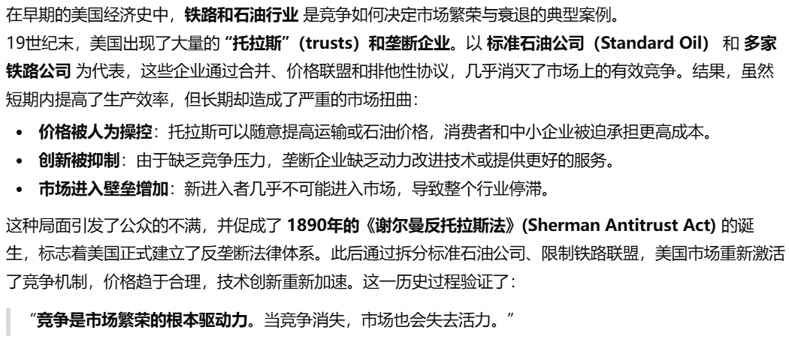
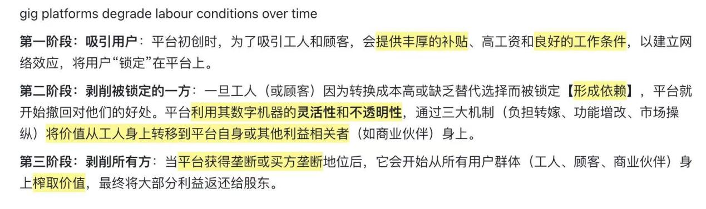
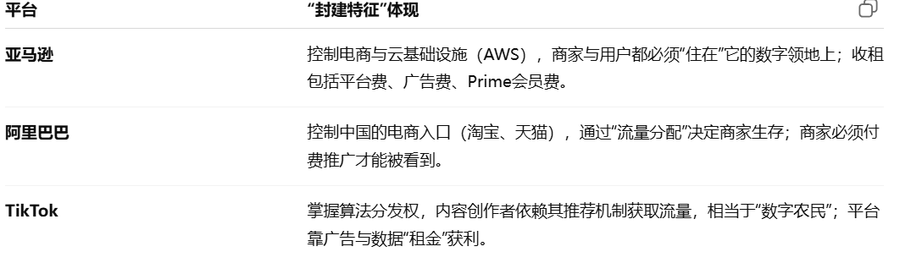
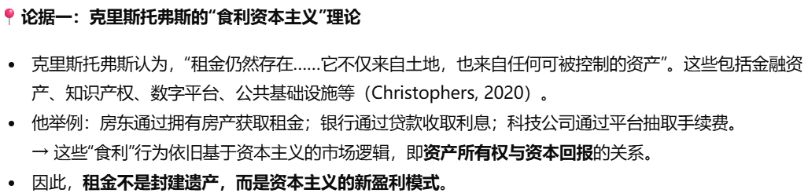

# Theme 5: Monopolies, Oligopolies, and Antitrust

[← 返回主题目录](../README.md)

---

## 1. Competition and antitrust law : a very short introduction竞争与反垄断法：极简导论
**Ariel Ezrachi**

1)  为什么要有反垄断法：

- 反垄断法产生的目的是：维护市场有效竞争，保护消费者福利（更低的价格，更好的质量，创新）CWS

  EX：（垄断的例子，可以作为垄断的后果）

  

2)  反垄断法的三大核心部分：

<!-- -->

1.  限制形成反垄断协议

    禁止企业间创造限制竞争的协议。

    EX:卡特尔行为（属于垄断协议的一种行为）：指多个相互独立的企业之间达成秘密协议（collusion），假装竞争，共同操纵市场，例如固定价格、划分市场、限制产量或联合抵制竞争者。

2.  禁止滥用市场支配地位

    一个企业虽然在市场上合法获得支配地位（如垄断者），但利用该地位排除竞争对手、限制市场进入是不被准许的。

    EX：滥用市场力量规制的挑战与数字时代的新问题：

    企业可能通过平台优势、数据优势、用户网络锁定等方式获得并维持支配地位，从而更容易开展排除性行为。

    例如：Google LLC，其核心产品——Google搜索引擎（Google Search）在欧洲长期占据超过90% 的市场份额。Google利用其在“通用搜索服务市场”中的支配地位，不公平地将流量导向自家产品比较服务——Google Shopping，而排挤了竞争对手（如 Kelkoo、Foundem、Ciao 等独立价格比较网站）。

3.  禁止反竞争性并购

    对企业并购等集中行为进行事前审查，防止形成垄断等反竞争行为。

    EX: 合并与收购: 合并可能促进效率，但也可能损害竞争。

    合并的益处：带来规模经济，促进企业内的创新与研发，避免重复投资与浪费。

    合并的坏处：数据集中化，生态系统锁定，杀手级收购。

<!-- -->

3)  如何实现反垄断？

    A.明确法律禁止 B.侦查与监控机制 C.处罚机制 D.国际合作

4)  竞争与反垄断法面临的平衡问题：既要防止过度干预，也要防止反竞争行为的产生

    监管干预太少，反竞争行为（如卡特尔、滥用支配地位）可能泛滥，竞争过程受损，消费者福利受害。如果监管干预太多，可能打击本来健康的竞争企业、增加合规成本、抑制创新。

    没有一个“绝对正确”的执法强度；最优执法水平是动态的，必须随技术、市场与社会结构变化而调整。

5)  数字时代的反垄断法

    传统的反垄断法是以消费者福利为中心（低价）的，这个判断标准在当下数字时代可能失效

    （例如像 Google、Facebook 这样的服务对用户是免费的）。

    因此，反垄断监管机构必须超越价格维度，将数据隐私、创新和服务质量等因素加入考核标准。

    解决办法是重新界定评估标准，将更广泛的社会目标（如公平性和可持续性）纳入考量。

6)  在判断是否存在滥用、卡特尔、合并损害竞争等垄断行为之前

<!-- -->

1.  需要判断市场的范围，这样才能计算出企业的市场份额，才能对其是否进行垄断有了判断。

2.  要区分激烈的竞争行为和排除竞争的行为。

    ## Enshittification相关的内容

<!-- -->

## 2. 2a. Way past its prime: how did Amazon get so rubbish? Cory Doctorow
主要观点：亚马逊变“烂”不是因为技术退步，而是因为平台垄断后，开始系统性地榨取用户、商家和劳动者的价值——这正是“平台衰败（enshittification）”的典型过程。

- A.“平台劣化”（Enshittification）的生命周期

  平台劣化是Doctorow提出的，是指：平台服务随着时间的推移逐步变坏的过程。

  大型互联网平台从初期优待用户到锁定商家再到为了挣钱牺牲用户和商家的过程。

  第一阶段：平台对用户很好，提供低价、好服务、便捷体验。

  EX: 亚马逊最初以低于成本价销售商品并且补贴运费。

  第二阶段：一旦用户被锁定（换平台成本高，会员绑定），平台便减少对用户的福利，将此节省的价值转移给商业客户（商家）。

  第三阶段：平台开始剥削商家和用户，为自身抽取最大价值。文章指出 Amazon 就处于第三阶段。

  EX:（对第三方商家征收高额费用已高达销售额的45%至51%，控制搜索排名，克隆热销产品，修改流量规则，从而削弱商家并将价值抽回给自身。

  用户体验下降：搜索结果都是带有偏见的，会优先推亚马逊自身的商品或者交了高昂排名费用的商家商品，寻找好商品难，假评论，价格反而变高。）

- 该如何解决这个问题？不能只靠用户。

1.  结构性分离（要求平台拆分其零售业务和市场平台业务，禁止平台复制商家产品）、禁止掠夺性定价、以及将付费驱动的搜索结果视为欺诈行为进行监管。

2.  实行反垄断法和互操作性（数据是真正属于用户的，用户可以将自己的数据带走）来解决这个问题。

3.  通过各种groups（消费者、工人、商家、竞争者和活动家）形成的广泛政治联盟，推动建立更好的监管和立法（完善反垄断法），从制度上约束平台权力。

    为什么“劣化”（Enshittification）会发生？

    Doctorow 认为与法律／监管对于大型平台的约束力下降有关。以“消费者福利标准”为主导的反垄断理论，使很多规模巨大的平台能以“价格低”为辩护，逃避对于锁定机制、市场结构、平台主导地位的严格审查。以前制定的反垄断理论难以管理当前的问题。

<!-- -->

## 13. Bullseye (podcast) with Jesse Thorn: Cory Doctorow
并且以facebook来举例子。

**Doctorow认为该怎么改进它？**

（反垄断法）

- 打破垄断结构，减低切换门槛

  要用政策或法律措施限制大型平台的垄断行为，比如阻止他们通过兼并小公司进一步巩固控制。同时，要降低新平台／小竞争者进入的门槛，让更多选择出现。

- 支持去中心化替代方案

  鼓励建立多个较小、开放、可竞争的平台，而不是依赖少数巨头。

  （其实第一和第二个我觉得就是打破垄断，有竞争）

- 让用户可以真正离开（互操性）

  用户一旦觉得平台体验差，应该有权利“搬家”而不会失去社交网络、内容历史。

  他说：平台让你“离不开”它，改进应当是让“离开”成为可行选择，而不是被迫留下。

  （这一点很难，因为你在平台里面很多时候是一个关系链，里面有你的朋友有记录等，你自己的数据记录可以拿走，但是关系网很难完全脱离）

  ## 2b. The Age of Enshittification Kyle Chayka

  观点与Doctorow一样。

## 3. “Enshittification” and the Future of AI Tim O’Reilly and Cory Doctorow
平台堕落论Enshittification在AI上的拓展，表达了Enshittification在AI上重蹈覆辙的忧虑。

Tim O’Reilly观点：人工智能领域，由于其巨大的网络效应和数据集中需求，极有可能重复传统的平台堕落模式。平台通过算法对注意力分配进行微调，将算法从服务用户（例如，显示最相关的内容）转向服务平台利润（例如，显示广告或高利润内容）。

EX: 谷歌搜索。它从一个致力于提供“最佳匹配”的引擎，演变为一个主要推送付费广告、平台自有产品的引擎。

建议的措施包括：1. 实行可互操作（允许用户将自己的数据迁移）；2. 强制要求透明度（要求平台说清楚，是怎么推荐信息的，内部结构是怎么样）；3. 制定能够反映社会价值而非短期利润的运营指标。

## 4. The “enshittification” of online information services obligates rigorous management of scientific journals Toomas Timpka
作者用“平台劣化”来类比学术期刊：就像很多互联网平台一开始用户体验很好，后来为了赚钱变得越来越“烂”，学术出版/期刊也可能因为利润等原因，变得越来越不可信、质量越来越差。

学术期刊会怎么“变烂”？

AI 造假 + 论文工厂：用大模型批量生成假论文、假数据，混进期刊。

出版商过度逐利：更看重赚钱和数量，审稿把关变松，质量下降。

学术信任被破坏：大家越来越难分辨研究是真是假，科学体系的“可信度”受影响。

三重防护机制：

\(1\) 严控审稿流程

\(2\) 研究者应当主动维护科学真相，在面对错误或虚假信息时敢于发声、质疑与揭露

\(3\) 完善伦理健全、可持续的同行评审体系

## 5. The Enshittification of Work: Platform Decay and Labour Conditions in the Gig Economy
**Michael David Maffie; Hector Hurtado**

Maffie和Hurtado探讨了零工经济中工作的"垃圾化"现象。Maffie和Hurtado将其扩展到劳动领域，提出“平台衰变框架”，认为平台对劳动者的剥削是一个结构化，分阶段的过程。

通过采访30个网约车和杂货配送平台工作的劳动者得出结论。

three mechanisms of enshittification：

<!-- -->

1.  平台逐步将运营成本、风险转移给劳动者，减少劳动者的奖金等。

2.  平台不断更新功能或规则，使劳动者工作强度更高。

3.  平台操控市场，使得劳动者数量变高，工资变低。

    作者最后将这些发现与“enshittification”理论结合，指出：平台劳动的恶化并非单一企业贪婪，而是由平台经济结构与算法治理逻辑驱动。监管者与研究者应将重点放在监督平台的算法怎么用、怎么改，并让这些算法更透明、更受监督。

    ## 技术封建主义相关内容

EX：苹果应用商店收取30%的税。
苹果公司通过App Store提供应用程序下载，并对付费应用程序收取30%的佣金。

<!-- -->

## 6. Technofeudalism: the video (short) Yanis Varoufakis本人对《技术封建主义（Technofeudalism）》这本书所作的总结性讲解。
观点：目前正在从资本主义走向技术封建主义。

<!-- -->

1)  技术封建主义是指什么？

    技术封建主义是**Varoufakis**提出的一个概念。

    “技术封建主义”是指：在数字时代，权力掌握在“云资本”（cloud capital）的拥有者手中。在这种体系下，用户通过向数字平台提供免费的数据和劳动，变成了“云农奴”（cloud serfs）；而平台则像“数字封地”（digital fiefs）一样，依靠云资本从用户身上收取“租金”获得利益。不仅普通消费者依赖这些平台，甚至传统企业也必须依托平台才能运转，因此平台能够持续从各方抽取租金。

2)  技术封建主义的例子：

    

3)  为什么说科技封建主义不是传统的资本主义？

- 资本主义的核心逻辑被改变了

  资本主义时代经济运行依靠利润，即通过竞争获取投资获得利润。现在经济运行不再依赖利润，而是以来租金。

<!-- -->

- 权力结构的变化：从“资本家主导市场”到“平台主导资本家”(普通企业就算有产品，也得依附平台才能触达用户。)

4)  Varoufakis说如果我们仍然用“反垄断”“市场自由竞争”这些旧观念来应对，就会治标不治本。因此，认清这是一个“新体系”，是改变现状的第一步。

5)  Varoufakis提出的解决方法：

<!-- -->

1.  瓦鲁法基提出用户在一段时间内不使用特定平台来抵制平台

2.  利用金融市场打击big tech（规模巨大、在数字经济中占主导地位的科技公司）的股价

<!-- -->

## 7. Two reviews of TECHNOFEUDALISM by Conservative Publications
以下是两位政治立场偏右的评论家对《技术封建主义》的两篇书评

The European Conservative（Carlos Perona Calvete ）

<!-- -->

1)  他认同瓦鲁法基斯的几点：

- “云资本主义”确实是当前存在的现象。

- 财富获取的方法也变了。现在赚钱的关键不在于创新和生产，而在于控制平台，算法和注意力。

2)  质疑：

- “封建主义”比喻有点夸张。

  现代劳动者虽然被剥削，但与传统“农奴”不同，他们依然可以自由选择工作与平台。

3)  解决方案与出路

- 加强国家监管与反垄断措施

  包括拆分科技巨头（break up giants）、平台国有化（nationalise the platforms），以及完善反垄断法律体系（improve the antitrust law）。

- 推广开源技术与本地化平台，让人们在“云之上”拥有更多自主权。

  （多推广开源技术（代码公开、任何人都能用/改/自己部署），再配合本地化的平台（政府/社区/学校/公司自己能掌控的数据中心、服务器或私有云））

  Robert Bellafiore（作者对瓦鲁法基斯的总体看法）

1)  反对：

- 租金并非新现象，在资本主义时代就有收租。现在资本主义中就有很多租金，比如专利，版权等。EX：连锁品牌收取加盟费；Windows操作系统得授权费，没卖一台电脑就收一次授权费。

- Robert Bellafiore认为当今的现象更接近 “咽喉资本主义（chokepoint capitalism）”

- 瓦鲁法基斯呼吁“云叛乱（cloud rebellion）”，但没有给出实际可行的路径；他的政治呼吁显得理想主义、甚至有些“宣言式的口号”；作者认为，真正的改革需要更冷静、更细致的制度分析，而不是把问题浪漫化为“新时代的斗争”。

2)  积极肯定：

- 资本主义确实在被技术改变。

- 互联网确实从开放自由变得垄断。

- 用户丧失数字自主权，人们对“数据与身份失控”的焦虑是真实的。

## 8. Capitalism is capitalism, not technofeudalism Nicholas Gane
<!-- -->

1)  反对

- Gane认为当代社会应被理解为“食利资本主义”，而不是瓦鲁法基斯所谓的“技术封建主义（Technofeudalism）”。

- 认为V误把资本主义的 “金融化”误认为是 “封建化” ，“收租现象”其实早已是资本主义体系的一部分

  

- V误把社会危机当作制度转型

  Gane 指出，V把当下的通货膨胀、贫富差距和生活成本危机解释为“技术封建主义的结果”，这是误读现实。Gane 认为，这些问题其实是新自由主义政策削弱福利国家的结果，而非制度从资本主义转向封建主义。

## 9. Dr Oli Sharpe's "Go Meta" video review of "Technofeudalism"
Oli Sharpe不赞同Varoufakis地观点。

对于被迫选择：去沃尔玛也是被迫选择(超市已经帮你选过一轮)。

对于租金行为，超市里面的牛奶，其实也是一种租金行为。

Varoufakis认为现在的民主政府已经太弱，根本无法控制亚马逊、谷歌这类掌握云技术和数据的超级公司。国家想监管或拆分它们几乎是不可能的。

Oli Sharpe不赞成他的观点，

- Oli Sharpe在新冠时期看到了国家在拥有采取行动的政治意愿时可以多么强大。

- 欧盟最近通过了一项法律，强制苹果公司允许其他应用商店在iPhone上架。

- 欧盟和美国联邦贸易委员会都在分别调查亚马逊的反竞争行为，并正确地指控亚马逊滥用其市场地位，既掌控市场又销售商品。如果罪名成立，欧盟和美国联邦贸易委员会都有权强制亚马逊改变这种行为，否则将面临巨额罚款。

## 11. Technofeudalism: What Killed Capitalism by Yanis Varoufakis Brooklyn, NY: Melville House, 2023

Anthony Pereira对Technofeudalism的评价

批评：

- 利润与租金的界线并不清晰。例如，在一些寡头垄断行业（比如航运、飞机制造）中，企业的利润来源既有“垄断性特权”，也有真实的创新能力，而这两者在现实中往往是混在一起的，很难分开。

- 不认可农奴是被迫的。

- 书中缺少系统数据来支撑“租金取代利润、平台统治市场”的幅度与趋势。

他声称“根据他的计算”，全球约 35% 至 40% 的 GDP 正在被“云租金”收入中吸走，但技术封建主义中没有这些计算。

- 大科技公司仍呈现鲜明的资本主义特征：他们向员工支付工资。他们向投资者出售公司股票。他们在市场上竞争。

- 未给出详细的解决方案。

  ## 咽喉资本主义（巨头控制了创意市场）

## 14. Chokepoint Capitalism: How Big Tech and Big Content Captured Creative Labour Markets and How We Will Win Them Back
巨头控制了创意市场

大型科技和内容公司通过平台垄断和法律漏洞控制chokepoint，同时剥削创作者和消费者的经济模式----【知识产权领域】

咽喉资本主义是指：大型科技公司（Big Tech）和大型内容公司（Big Content）通过利用其对关键市场“咽喉点”的垄断控制以及法律和监管漏洞，同时剥削内容创作者和消费者。

EX：

Amazon控制了绝大多数有声书市场。它强制要求作者使用DRM（数字版权管理）。导致用户买的书只能在Amazon播放，这样就能锁定用户。读者被锁定后，平台就能反过来对作者压价。

Spotify和三大唱片公司（Sony/Universal/Warner）等权利方签授权保密协议。从而压榨音乐家。

解决方案：

- 公开透明：让创作者了解平台如何使用与分配他们的内容收益

<!-- -->

- 法律完善：Copyright Reform 版权属于创作者

- 成立创作者联盟（creator coalitions）或组织工会（unions）

---

[← Theme 4](../Theme4/README.md) · [返回首页](../README.md) · [Theme 6 →](../Theme6/README.md)
