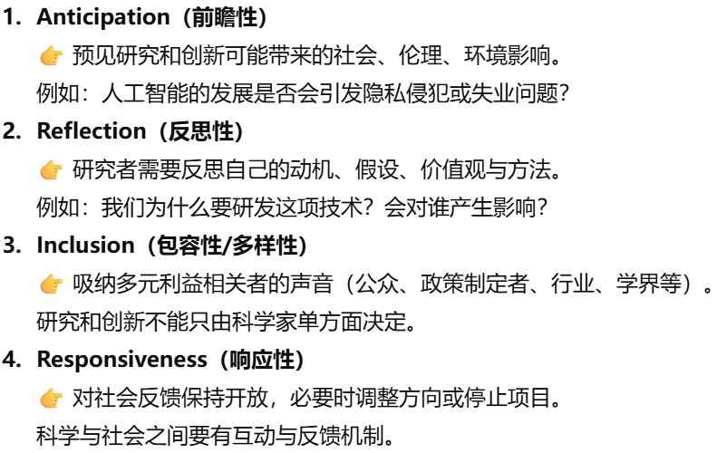
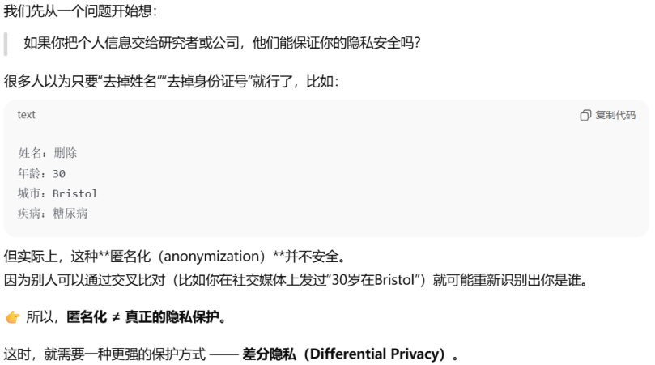
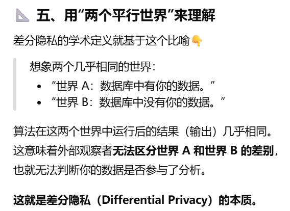

# Theme 6: Responsibility and Ethics（责任与伦理）

[← 返回主题目录](../README.md)

---

虽然可以合理地假设，大多数数据科学家都希望在法律允许的范围内行事——前提是这些法律本身是合理的——但仅仅遵守法律往往仍然留有相当大的余地，也就是说，有许多不同的行为方式都在法律允许范围内，但其中有些可能不够负责任，或不够符合伦理。

因此，我们的第六个主题是“责任与伦理”（Responsibility & Ethics）。在这一主题中，我们将探讨“负责任的研究与创新”（Responsible Research & Innovation, RRI）这一概念——近年来这一理念已被许多大型机构所采纳。

## 1.  Responsible Research and Innovation: Why? What is it? Richard Owen

（就是在你进行科技发展的时候，有个**RRI框架**约束着你，让你的科技发展不会胡乱发展，不会危害到社会，伦理道德）

负责任的研究与创新（RRI）：是一种方法，确保在进行科技发展创新时，不仅追求技术进步和经济利益，还要确保发展不会对社会产生负面后果。

<!-- -->

1)  科学和创新可以创造未来

2)  创新是社会，政治和伦理的结合体

3)  （视频中说）想要实现负责任的研究与创新必须要这么做：

&nbsp;

RRI的优势：

- 与社会需求一致（Alignment with Societal Needs）

  确保研究与创新（R&I）活动能够回应现实世界的问题，并符合社会期望。

- 降低风险（Mitigating Risks）

  在过程早期就识别并处理伦理、环境和社会方面的风险。

- 建立公众信任（Building Public Trust）

  透明性与包容性能够提升公众对科学与技术进步的信任与接受度。

- 促进可持续性（Promoting Sustainability）

  鼓励采用可持续做法，以保护未来人们的利益与环境。

&nbsp;

  RRI 在实践中的体现（RRI in Practice）

- 公众参与（Public Engagement）

  促进与社会的开放对话，纳入多元观点。

- 科学教育（Science Education）

  提升学生与公众对研究与创新（R&I）的认识，培养负责任的科学文化。

- 性别平等（Gender Equality）

  确保在 R&I 活动中实现平等代表与平等参与。

- 开放获取（Open Access）

  将研究成果向公众开放，以促进透明性和可获取性。

- 伦理治理（Ethics Governance）

  建立并执行伦理指南与政策，对 R&I 项目进行负责任的监督与管理。

&nbsp;

  RRI的劣势

- 平衡创新与监管（Balancing Innovation and Regulation）

  创新者可能觉得 RRI 过于“限制性”，从而可能拖慢研究与创新（R&I）的推进速度。

- 利益相关方参与的复杂性（Stakeholder Engagement Complexity）

  让多元群体参与并不容易，因为不同群体的目标、价值观和利益可能不一致甚至冲突。

- 资源投入大（Resource Intensity）

  RRI需要额外的时间、资金和资源，用于公众咨询、伦理审查以及持续监测。

- 影响衡量不确定/困难（Uncertain Impact Measurement）

  评估RRI很难，需要长期的数据和独特的评估方法。

## 2. How to apply Responsible Research and Innovation (RRI) in industry – an interactive guide
一段简短的动画，讲解如何在实践中应用 RRI，虽然动画主要聚焦于电子健康（e-health）公司，但其中传达的核心理念其实并不限于这一领域，具有更广泛的适用性。

<!-- -->

1)  确保满足人们的期望。（确保用户的医疗数据具有高隐私性，生产的产品是安全的，生产步骤是合规的，以及以积极的态度对待公司员工）

2)  e-health该如何做才能符合RRI

    企业需要证明其在道德，社会和环境方面都负责（要进行负责任的研究与创新）。

    【为了满足这一点，需要从原型设计到产品上市，每个环节都需要消费者的参与（包容性）；确保工作场所的健康和多元化；利用一些工具去帮助您预测未来风险并且分析产品或者生产过程对环境，社会或健康的影响（预测性）；分析组织是否符合合格的规范和标准（反思性）】→ 这些要素构成公共研究治理框架的一部分（RRI）

3)  企业遵守负责任的研究与创新原则（RRI）的优势是什么？

- 生产出顾客满意的产品，从而确保市场竞争力（遵守RRI，会加强企业与顾客的沟通）

- 说服国家机构投资你的产品(因为 RRI 让产品更合规、更安全、风险更低)

&nbsp;

  **关键步骤：应用 RRI 的框架**

  步骤 1：预测性（Anticipation）

  含义： 提前考虑研发和技术创新可能带来的社会、伦理、环境和经济影响。

  实践：

  利用一些工具去识别潜在风险（如患者数据隐私问题）。

  步骤 2：反思性（Reflexivity）

  含义： 对研发过程和创新目标进行批判性反思，质疑其是否符合规范，是否符合RRI。

  实践：

  提问：技术是否符合用户的真实需求？

  评估：是否有潜在的偏见或不公平？

  步骤 3：包容性（Inclusion）

  含义： 将利益相关者（stakeholders）纳入研发过程中，进行多方合作，确保多样化的视角和公平决策。

  实践：

  吸纳用户、患者、医生和社会团体的意见。

  在技术设计阶段融入多方建议，避免单一视角。

  步骤 4：响应性（Responsiveness）

  含义： 根据反馈和新发现灵活调整技术设计或目标，以满足动态需求。

  实践：

  根据用户反馈修改系统功能。

  遵守法规变化，如GDPR对数据隐私的要求。

## 3. The Ethical Algorithm \| Michael Kearns & Aaron Roth \| Talks at Google
“Michael Kearns 和 Aaron Roth 于 2019 年底在 Google 进行了一场双人对谈式的讲座，讨论他们的著作《The Ethical Algorithm》

核心内容概述

Michael Kearns 和 Aaron Roth 在这次讲座中探讨了他们的书 The Ethical Algorithm: The Science of Socially Aware Algorithm Design 中的核心观点。他们聚焦于算法的伦理设计（在设计算法得时候嵌入伦理原则，加入不同的公平性规则），提出如何在算法性能和社会价值（如公平性、隐私和透明性）之间取得平衡。

    

<!-- -->

1.  算法的双刃剑（The Double-Edged Nature of Algorithms）

    优势：

- 算法可以高效处理大规模数据。

- 广泛应用于医疗、金融、招聘和社交媒体等领域。

  风险：

- 当算法基于偏见数据训练时，可能放大不公平现象。

- 隐私泄露和透明性缺乏是常见问题。

2.  算法在应用时面临的问题和解决方法：

- 算法本身并非天生中立或客观，我们需要在设计算法得时候嵌入伦理原则，加入不同的公平性规则，使算法在实现目标的同时遵守社会价值。（如公平、公正与隐私）

- “Ethical Algorithm = 通过算法设计实现伦理原则”

  B.1 偏见与公平性（Bias and Fairness）

  问题：算法可能强化现有的不公平现象，例如基于种族或性别的歧视。

  解决方案：

<!-- -->

- 将伦理约束（如“公平”、“隐私”）设计成可计算的数学目标，并将其直接嵌入到算法本身的设计之中，这样算法的所有结果都能够符合伦理行为。

  B.2 隐私保护（Privacy Protection）

  问题：如何通过数学上的定义将隐私和公平等社会价值融入算法。（模型会记住训练数据里的细节，可能把训练集里出现过的手机号、地址、身份证号、私密文本“背下来”，被人用特定提示词套出来。）

  解决方案：

- 应用差分隐私（Differential Privacy）技术（别人更难从模型里套出与你相关的具体信息）

- 通过在数据中添加噪声，保护个人隐私，同时保留数据的整体统计特性。

- Google 和 Apple 等公司已将此技术应用于产品。

  B.3 算法透明性（Algorithmic Transparency）

  问题：复杂的机器学习模型，如深度学习，被视为“黑箱”，难以解释其决策机制。

  解决方案：

- 开发可解释人工智能（Explainable AI, XAI）工具。

- 对决策过程进行可视化和记录。

3.  伦理算法设计的框架（Framework for Ethical Algorithm Design）

- 明确伦理目标（Define Ethical Objectives）

  在设计算法时，需明确优先解决的伦理问题（如减少偏见或保护隐私）。

- 数学建模（Mathematical Modeling）

  使用数学方法将伦理目标形式化，以便将其纳入算法设计中。

- 性能与伦理的权衡（Trade-offs Between Performance and Ethics）

  强调算法性能与伦理价值之间的平衡，避免“零和博弈”心态。

- 动态改进（Iterative Improvement）

  在应用算法时，持续收集反馈，并根据新的伦理问题调整设计。

4.  实践中的伦理算法（Ethical Algorithms in Practice）

    Amazon 曾开发一个 AI招聘筛选工具，用来自动筛选候选人简历。但该算法在训练时主要以历史招聘数据（绝大多数成功应聘者是男性）为基础，结果学会倾向男性候选人。

 5. 伦理算法的未来方向（Future Directions for Ethical Algorithms）

- 更加广泛的多学科合作，包括伦理学家、法律专家和社会学家。

- 建立政策框架，规范高风险领域的算法应用（如医疗和执法）。

- 开发更强大的工具，用于实时监控算法偏见和伦理问题。

## 4. Michael Kearns: Differential Privacy
Michael Kearns 向 Lex Fridman 解释“差分隐私”（Differential Privacy）。

Differential Privacy是什么？

差分隐私的目标是：即使你的数据被加入数据库，分析结果也几乎不会变。也就是说，别人无法判断你是否在数据库中，因此也无法知道你的隐私。（任何单个个体是否在数据集中，对算法输出的最终结果几乎不产生可察觉的影响）

让大家学到群体层面的信息（statistical patterns），但无法推测任何一个具体个体的隐私。

如何实现差分隐私？

\[既然数据中有我和没有我，结果几乎一样，那算法是怎么做到的？\]

首先，差分隐私并不要求结果完全一样，而是：结果之间的差异足够小，小到外部观察者无法确定是否有你的数据。

它是怎么“让结果差不多”的？

答案是：在计算结果中加入随机噪声（noise）！算法在输出结果前，会故意添加一点“随机误差”，这样即使你的数据影响了原始结果，这个差异也会被随机噪声“掩盖掉”。

## 5. k-Anonymity: A model for protecting privacy by Latanya Sweeney
<!-- -->

1)  一个数据持有者（data holder），比如医院、银行或社交媒体公司，想把自己收集到的数据分享给研究人员（researchers）做研究。但问题是：如果直接把数据公开，会暴露用户隐私（比如姓名、地址等）。如果把数据“完全打乱”或“删除太多信息”，那研究人员又用不了这些数据。所以目标是：在保护隐私的同时，尽量让数据仍然有用。

2)  Sweeney 提出k-匿名性模型：通过泛化（generalization）和抑制（suppression）等技术，让每条数据记录都至少和其他 k−1 条记录看起来“差不多”。

3)  实现方法： 论文提出了实现k-匿名性的具体技术手段：

    泛化： 用一个更宽泛的值替代精确值（如将年龄“23”泛化为区间“\[20-30\]”，将邮编“02138”泛化为“0213\*”）。

    抑制： 直接删除某些过于独特、无法泛化的数据值或整条记录。

<!-- -->

## 6. On the Dangers of Stochastic Parrots: Can Language Models Be Too Big?
Emily Bender; Timnit Gebru; Angelina McMillan-Major; Shmargaret Shmitchell

核心思想：语言模型越大越好吗？我们是否忽视了其带来的环境、社会与伦理风险？

**盲目追求超大规模语言模型存在四大核心风险：环境成本（高能耗加剧气候不公）、数据偏见（放大社会歧视）、理解幻觉（误将无意义文本当作智能交流）和研究失衡（挤占多元化技术探索）。作者主张转向更可持续的发展路径，包括采用高效模型架构、精心策划训练数据、加强模型透明度，并推动超越规模竞争的负责任创新。**

追求模型规模的“bigger-is-better”可能带来多重危险，包括：

<!-- -->

1.  环境与经济成本高昂

    （训练一个模型的能源消耗可能相当于一个普通美国人好几年甚至一生的碳排放量，但其带来的利益（如先进的AI产品）却主要由富裕的科技公司和地区享有，而气候变化的恶果则由全球社群，尤其是贫困地区共同承担。这是一种典型的成本外部化。）

- 训练超大模型消耗巨量能源与金钱；

- 排放大量二氧化碳，加剧气候变化；

- 成果主要由富裕机构享受，弱势地区却承担环境代价。

2.  数据偏见与不透明性

    数据偏见：

- 模型训练依赖网络海量数据，但这些数据充满偏见（性别、种族、文化歧视等，而这些数据往往过度代表：有特权群体（白人、男性、健全者等）的语言；包含性别歧视、种族主义、能力歧视等偏见。）；

- 数据主要来自西方（英语互联网），忽视世界多数语言与文化；

  数据不透明：

- 缺乏系统的数据文档与问责机制，造成“文档债务（documentation debt）”。

  文档债务：现在很多大语言模型（比如 GPT-3）都是用海量、未经精心筛选的数据训练出来的。但是这些数据：没有清楚记录来源；没有说明数据选择标准等。就形成了“文档债务”。未来如果研究者想分析这些模型为什么会带有偏见、错误知识等问题，就会发现因为早期没留下完整文档，现在很难追溯、难以修复。

3.  模型幻觉扩大偏见与错误信息。

- 模型只是模仿语言模式，并不理解意义；但其流畅输出容易让人误以为它具备理解与思考能力；

- 这种“仿真式智能”风险包括虚假信息扩散、偏见放大、错误决策等。

  （人们盲目相信机器生成内容）

4.  研究方向偏移

- 学界过度聚焦“语言模型在测试集上的高分”，忽视真正理解语言的研究；

- 小规模、可解释、低能耗的替代方案被边缘化。

&nbsp;

作者的主要建议：

1.  数据收集应以质量与透明为核心

- 研究人员应当花时间：精心收集与研究目标匹配的数据集，而不是一味只追求数量；

- 理解大规模数据并不意味着多样性

2.  加强文档

    创建能够解释模型和数据集的文档，以便进行修复和便于监管。并且建立责任机制，让模型开发者能对模型负责。

3.  在系统开发中纳入小众群体（尤其是弱势群体）的价值与需求。

4.  不盲目追求更大模型；注重模型的社会影响、解释性、公平性与多语言包容性。

5.  建立问责与监管机制。

6.  重视环境

    在训练前评估碳排放与能耗；推动“绿色 AI”（Green AI）理念。

 **本篇文章的比喻：随机鹦鹉（Stochastic Parrots）**

 **随机鹦鹉：形容大模型只是机械地重复与组合语言片段，它看似聪明、实则不懂，像鹦鹉重复人话一样。**

<!-- -->

## 7. The Ethical Algorithm Vern McKinley
Vern McKinley在Regulation杂志中的这篇评论详细审视了 Michael Kearns 和 Aaron Roth 的著作 The Ethical Algorithm: The Science of Socially Aware Algorithm Design，并探讨了该书的核心观点、贡献以及潜在的局限性。

McKinley 的评价

2.1 对该书的赞扬

- 实际应用性：

  McKinley 认为，该书将抽象的伦理概念转化为具体的技术解决方案，使其对数据科学家和政策制定者具有高度实用价值。

- 可读性：

  书中的案例研究和解释使复杂的数学概念变得易于理解，适合广泛读者群体，包括非技术背景的读者。

2.2 书中的局限性

- 公平性定义的多样性：

  McKinley 提出，书中对公平性的讨论不够，没有讨论到地区不同文化不同会导致公平性也不同。

- 形式单一：

  McKinley认为算法的公平性应该靠技术和制度两方面实现。在算法层面（技术上）：我们要通过数学方法让模型在运行时尽可能“做出公正的决策”。在社会层面（制度上）：还需要有法律、监管和社会规范来约束和监督算法的使用，

  （尽管书中介绍了许多技术工具，但如何将这些工具与现行政策和法律框架结合仍有待进一步阐明。）

- 实际应用中的障碍：

  McKinley指出，书中对于现实世界的实现难度写的较少。例如，企业如何平衡实施这些技术的成本与其社会责任。

3. 与当前监管的相关性

3.1 隐私保护

  McKinley 强调，差分隐私技术在应对数据隐私保护法规（如 GDPR）方面具有显著优势，但其在广泛行业的部署仍面临技术复杂性和资源限制。

3.2 算法偏见

  他认为，Kearns 和 Roth 的研究为解决算法偏见提供了可操作的路径，但有效实施需要政策制定者、技术专家和社会科学家之间的紧密合作。

3.3 透明性要求

  McKinley 指出，书中的建议可以直接应用于当前关于算法透明性的监管讨论（如欧盟人工智能法案）。

4. 与“责任与道德”主题的关联

4.1 数据科学家的责任

  McKinley 认为，The Ethical Algorithm 对数据科学家提出了更高的伦理要求，强调他们不仅需要开发高效的算法，还需承担其社会影响的责任。

4.2 跨学科合作

  评论中提到，算法伦理需要法律、伦理、社会科学和技术领域的协作，以确保技术的负责任发展。

4.3 对公众信任的影响

  他指出，伦理算法的应用将显著提高公众对技术和算法系统的信任。

## 8. Ethical, political and epistemic implications of machine learning (mis)information classification: insights from an interdisciplinary collaboration between social and data scientists 机器学习中（误）信息分类的伦理、政治与认识论影响：来自社会科学家与数据科学家跨学科合作的洞见》 by Andrés Domínguez Hernández; Richard Owen; Dan Saattrup Nielsen; Ryan McConville

主题：

当我们使用算法去判断哪些信息是真是假时，这并不是一个纯粹的技术问题。对于算法的设计者来说，这一过程需要融入伦理思考、政治意识等。

<!-- -->

1)  为什么要研究这个问题

    现在网上信息太多，人工根本分不清真假，所以很多平台（像X、Facebook、YouTube）都开始用机器学习来自动识别错误信息。

    但作者提醒我们：算法在判断事物的真假，不是中立的，是带有数据选择者的价值判断。

2)  让机器学习在处理真假信息时更负责任的方法：

    伦理维度：如果机器把真消息误判成假消息，可能会对人有伤害（造成损失）

    因此，系统需要做到透明可解释并且加入责任追溯机制，确保出错时能找到并纠正问题。

    政治（Political）维度：机器的真假判断可能会影响大众的想法。因此算法设计者在进行算法设计时要明白自己其实也在参与政治方向的选择，不只是技术问题。

    认识论（Epistemic）维度：

    算法的结果输出其实是基于数据集的，算法不会思考，他只会通过数据集计算。

    因此算法研究者要学会反思，数据集中是否是真的真相还是带着自己的偏见。

    最后，文章提出了一些建议：

- 算法团队要有多学科合作，比如让社会科学家和数据科学家一起参与；

- 设计前要想清楚：算法出错时会带来什么后果；

- 系统要透明，让公众知道算法是怎么判断的；

- 要有纠错机制，防止算法偏见造成不公。

---

[← Theme 5](../Theme5/README.md) · [返回首页](../README.md) · [Theme 7 →](../Theme7/README.md)
