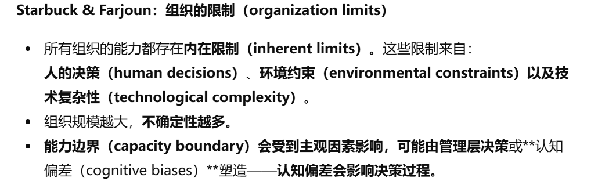

# Theme 7: Technology Failures

[← 返回主题目录](../README.md)

---

> 高风险技术的失败，即使这个技术是符合法律，伦理等也可能失败，失败的原因还可能是文化，系统等

## 1. Challenger: A Rush To Launch Jason Payne
挑战者号灾难概述

事件背景：挑战者号于1986年1月28日发射，升空73秒后解体，导致7名宇航员全部遇难。

技术失败原因：主因是固体助推器密封圈（O-rings）的失效。O-rings 在低温环境下失去弹性，无法有效密封燃料，导致泄漏。这一技术问题早在灾难发生前已被工程师发现，但未引起足够重视。

(发射当前的温度低于O型圈的安全温度，所以工程师不建议发射。但是高层认为之前O型圈也出现了很多问题也都没有事故发生。所以他们就认为没有问题。)

组织和文化问题：

- NASA内部的组织文化强调进度和成本控制，忽视了安全警告。

- 存在偏差的正常化现象：小规模的技术异常未导致重大问题，因此被逐渐接受为“正常”。

## 2. Space Shuttle Columbia - Falling Star HD
哥伦比亚号灾难概述

- 事件背景

  日期： 2003年2月1日。

  事件： 在执行 STS-107 任务期间，哥伦比亚号在重返地球时解体，7名宇航员遇难。

  技术问题： 发射时，一个隔热泡沫块脱落，撞击航天飞机的左翼，造成热保护系统受损。重返大气层时，高温气流进入机体内部，最终导致解体。

  组织文化问题：

<!-- -->

- 早期警告未被充分重视。

- 决策层未能进行更深入的风险评估。

## 3. Space Shuttle Challenger Disaster: Ethics Case Study No. 1
航天飞机项目前主管 Allan McDonald，在纪录片中讲述了他对挑战者号失事的看法。他当时深度参与了这次发射决策，并明确表示不应发射，但他的意见被忽视了。

McDonald 的反对：McDonald 和其他工程师明确指出，低温环境下的发射存在严重风险。他在发射前的技术讨论中坚决主张推迟发射。

NASA的忽视：管理层面临时间表压力和公众期待，选择无视工程师的警告。高层决定继续发射，导致灾难发生。

McDonald的观点：

管理层不应该忽视工程师在技术决策中的核心作用。

NASA决策中缺乏透明度和对异议的尊重是灾难的重要原因。

工程师不仅要解决技术问题，还应该确保技术安全。（技术伦理的重要性）

## 4. Mike Mullane - Normalisation of deviance - IAFF - Part 1
NASA宇航员Mike Mullane在一次讲座中，谈到了“偏差正常化”这一现象。

<!-- -->

1)  在挑战者号灾难中的表现：

    NASA在多次发射任务中观察到O 形密封圈（O-rings）性能问题。

    这些偏差虽未引发灾难，但未得到彻底解决，最终在极端低温条件下导致挑战者号的解体。

2)  观点：偏差的正常化是组织失败的根源，领导层在偏差的正常化中扮演关键角色

3)  应对偏差正常化的建议：

- 确保安全始终是组织的核心价值，而不是被次要目标（如进度或成本）压倒。（企业文化）

- 鼓励员工主动汇报问题，无论问题看起来多么微不足道。（企业文化）

- 领导层需营造一个鼓励质疑和反馈的环境，避免沉默文化。（企业文化）

- 定期对操作规范进行审查，防止偏差成为“习惯”。

- 通过案例分析和实战演练，帮助员工认识偏差正常化的风险。（教育培训）

## 5. The challenger launch decision. Risky technology, culture, and deviance at NASA
**Minkes**对**Diane Vaughan**的著作**The Challenger Launch Decision: Risky Technology, Culture, and Deviance at NASA** 进行了评论。

Vaughan 提出的核心理论是：**挑战者号灾难的根源是NASA的组织出现了偏差正常化。**

偏差的正常化：在组织内部，由于偏差没有带来立即的负面结果。导致人们逐渐接受这些偏差行为（这些行为超出了原本的安全规则和标准），以至于他们不再把这些行为视为偏差或风险。

<!-- -->

1)  NASA出现偏差正常化的原因：

- 异常在多次成功中弱化了风险感知（NASA 在挑战者号发射前多次观察到O形密封圈的问题，但由于这些偏差没有引发灾难，逐渐被接受为“正常”。）

- 文化偏差导致：NASA的企业文化是追求速度与成功并且由于政治方面等压力促使管理者将危险重新解释为可接受（NASA面临巨大的时间表压力和政治期待，优先考虑任务进度而非安全问题。）

- 组织结构导致：NASA的组织结构是特殊的，部门之间存在保密，导致信息无法很好的传播。层级沟通过滤使工程师的警告被淡化或阻断，从而领导层认为这个错误也没那么严重也是可以被接受的。

（生产文化追求成功，高压文化普遍，优先考虑进度也导致了偏差正常化，组织结构需要层级沟通也导致偏差正常化）

- 组织者的决策选择

&nbsp;

对策（偏差正常化）：

- 重塑组织文化，例如：鼓励工程师提出担忧和疑问，重视安全。

- 优化组织结构，例如：确保信息透明。

- 制定明确的政策，要求对任何技术偏差或者异常进行彻查。

- 制定更清晰且严格的评估标准。

  EX：美国德州电网大停电：电网设备未进行防寒改造，每次小型寒潮后没出现严重后果，极端天气下系统整体崩溃。

Minkes的评价：
  
  赞扬：

1)  赞扬Vaughan的研究将灾难视为文化和技术失误的共同结果。

2)  偏差正常化帮助解释了复杂组织中风险被低估或忽视的原因。这一理论在其他领域同样具有广泛适用性。

   缺点：

3)  认为Vaughan太强调结构因素和文化因素导致事故，而可能忽略了高层的个人责任。

4)  Vaughan的“偏差正常化”解释引发争议（尤其与 Feynman、Allinson 等人），Vaughan 认为NASA的错误是制度文化（偏差正常化，强调按时完成任务等）导致。而Feynman则认为 NASA的错误是主动欺骗、伪造风险数据。Allinson关注道德责任，批评管理层失职，而不仅仅是文化影响。

<!-- -->

## 6. The Challenger Launch Decision: Risky Technology, Culture, and Deviance at NASA
Short 评论Vaughan的书 《The Challenger Launch Decision》

<!-- -->

1)  Short赞扬Vaughan对“偏差正常化”的解释非常创新且强有力。

2)  Short赞扬Vaughan的方法论严谨。

3)  Short赞扬Vaughan比总统委员会的调查深入得多、解释力更强。

<!-- -->

## 7. Organizing at and Beyond the Limits M. Farjoun & W. Starbuck （不确定）

## 8. Organization at the Limit: Lessons From the Columbia DisasterOrganization at the Limit: Lessons From the Columbia Disaster Edited by StarbuckWilliam and FarjounMoshe, Malden, MA: Blackwell Publishing, 2005
Banerjee和Mahoney的书评对Starbuck和Farjoun编辑的著作 Organization at the Limit: Lessons from the Columbia Disaster 进行了深入评价。

高度评价

- 对高风险组织具有很强的现实启示。

- 本书结合了管理学、社会学和工程学的理论框架，提供了对高风险技术系统失败的全面分析。

- 本书深入探讨了偏差正常化如何成为组织决策中的系统性问题，这一观点具有深远意义。

  小小建议：

<!-- -->

- 书里讲了很多“问题如何产生、如何恶化”，但对一个关键问题着墨不够：“组织到底在什么时候算是走到了极限？有没有一套清晰指标，可以让管理者提前知道极限的到来。

## 9. Allan J. McDonald;, James R. Hansen. Truth, Lies, and O‐Rings: Inside the Space Shuttle Challenger Disaster . xix + 626 pp., illus., bibl., index. Gainesville: University Press of Florida, 2009. \$39.95 (cloth)
<!-- -->

M.Neufeld对McDonald与Hansen《真相、谎言与O型环：挑战者号航天飞机灾难内幕》的书评。

书的核心内容：挑战者号事故的具体细节，解释了NASA的组织文化问题。强调高层对技术反馈的冷漠是导致问题发生的重要原因。

<!-- -->

1)  Neufeld专门拿它与Vaughan 的《The Challenger Launch Decision》作对比：Vaughan 用“正常事故”“组织文化”等社会学概念，强调复杂系统中的结构性问题，容易“稀释”个人责任和道德抉择；McDonald 的书则把焦点重新拉回具体人的决策与道德选择上：谁坚持反对、谁屈服于压力、谁试图事后掩盖。

Neufeld的评价：

2)  对本书的赞扬

- Neufeld对书中技术问题的详尽分析和对NASA组织文化的批判表示肯定。

- 赞赏通过使用第一人称叙述的方式将这本书不但有故事性还有说服力。

- 本书揭示了工程师如何在高风险技术决策中平衡科学伦理与组织压力。

3)  对本书的批评

- 由于本书以McDonald的视角为主，可能忽略了 NASA 其他成员的观点。过于主观。

- 书中更多关注NASA内部的文化和管理问题，而对外部政治和经济压力的分析不够深入。

## 10. The Next Catastrophe: Reducing Our Vulnerabilities to Natural, Industrial, and Terrorist Disasters
Charles **Perrow**在Microsoft Research的演讲。Charles Perrow 在这场演讲中介绍了他的经典理论：**正常事故理论（Normal Accident Theory, NAT）。**他解释了高风险技术系统中的复杂性和紧密耦合如何导致灾难，指出在某些系统中，事故是不可避免的。

Perrow观点：在同时具备高复杂性与紧耦合性的系统中，事故是不可避免的。这些“正常事故”源于系统结构本身，而非个人失误。

<!-- -->

1)  正常事故理论（Normal Accident Theory, NAT）：在复杂且高度耦合的技术系统中，事故是不可避免的，即使在最严格的管理下也无法完全避免。

    复杂性（Complexity）：系统的多层次和多组件增加了预测和控制难度。

    紧密耦合（Tight Coupling）：系统中组件彼此高度依赖，局部问题容易迅速扩散为全局危机。EX：航天器中的部件故障迅速影响整个任务。

2)  Perrow将系统分为四种类型：

    简单-松散耦合（Simple-Loosely Coupled）： 容易管理（如农场）。

    简单-紧密耦合（Simple-Tightly Coupled）： 容错性较低（如流水线）。

    复杂-松散耦合（Complex-Loosely Coupled）： 复杂但灵活（如大学）。

    复杂-紧密耦合（Complex-Tightly Coupled）： 最危险的类型，易引发灾难（如核电站、航天器）。

3)  EX:

    三哩岛核事故（Three Mile Island）：核电站的复杂性和紧密耦合导致操作人员难以及时识别和处理问题，最终引发事故。

    挑战者号航天飞机灾难：Perrow 认为，复杂的航天任务中任何一个小问题（如 O 形密封圈失效）都可能因紧密耦合而升级为灾难。

4)  减少高风险系统中事故的方法

- 降低复杂性：通过简化设计，将复杂系统划分为独立模块，制定简洁易懂的操作流程从而降低操作的复杂程度。（简化设计，简化操作流程）

  例子：核电站通过优化设计减少监控和操作的复杂程度。

- 松散耦合：引入冗余和缓冲机制。（添加备用组件，避免关键组件互相依赖，进行独立性设计）

  （缓冲机制：为关键系统组件引入时间或资源缓冲，以提供故障修复的空间。冗余设计，增加系统中的备用组件，使系统在局部失效时仍能运行；解耦关键组件：避免关键组件之间的直接相互依赖，通过独立性设计减少连锁反应的风险。）

  例子：航空系统中采用双引擎机制。

<!-- -->

- 提高透明度：确保每个部门和层级的沟通顺畅。

<!-- -->

- 组织文化改进：组织需要建立一种“安全第一”的文化，鼓励员工提出风险并及时应对。

5)  提出正常事故理论的优势：为理解高风险技术系统的失败提供了强有力的理论框架，特别适用于核电、航天和金融领域。（能够更好的理解高风险系统为何失败）

    EX: 软件开发有衡量标准，高内聚，低耦合（依赖程度低）。

<!-- -->

## 11. Normal Accidents: Living with High-Risk Technologies
Simms对 Charles Perrow《Normal Accidents》的书评

<!-- -->

1)  Perrow引用管理理论指出：复杂系统需要去中心化（分权）才能灵活应对，但紧耦合的系统又需要高度集中管理才能控制风险，两者完全冲突。系统内部结构无法满足系统运行需求因此会出现事故。因此，Perrow认为某些系统根本不可能设计得足够安全。

2)  Perrow把技术风险分成三类：

- 无望类：必须完全放弃

  例如：核电站

  理由：系统不可控，又是紧耦合且复杂，一旦事故影响巨大。

- 暂时太危险类：暂停

  当时的“基因工程（DNA研究）”。

- 有风险但可部分自我纠偏类：限制使用

  例如：化工厂，民航系统，空管系统。

3)  Simms对Perrow的主要批评包括：

- Perrow的案例分析不够专业。没用足够的技术细节和专业数据。

- Perrow加了很多社会学概念，这些内容并没有真正增强论证，反而让书显得有点散、不够聚焦。

- Perrow提出的分类是非常有价值的框架，对理解高风险技术系统的危险机制有重大意义（可以根据框架判断企业属于哪一类，再做出改进或者预防措施）。

## 12. Normal accidents; Living with high-risk technologies
Ravetz在这篇评论中对Charles Perrow的经典著作Normal Accidents的评价。

- 事故不仅仅是系统造成的，还和组织文化和组织里的权力关系有关。

<!-- -->

- 批评Perrow的分析更多基于案例研究，缺乏量化数据的支持。

- 批评Perrow对技术失败的社会后果和伦理责任的讨论仍显不足。

## 13. Reason explains Swiss Cheese Model
在这段视频中，James Reason 简明扼要地介绍了他的“瑞士奶酪模型（Swiss Cheese Model）”，用以解释技术事故的发生机制。

观点：高风险系统中的事故往往是多个层次防御机制同时失效的结果，而非单一原因引发的事件。

<!-- -->

1)  Reason认为，在复杂系统中存在多层“防线”（保障机制）用以防止事故发生。但是他用“奶酪的孔”这一比喻每道防线都有漏洞（潜在条件、主动错误），这些漏洞可能会“对齐”。如果几道“奶酪片”中的漏洞对齐了，就会出现一条路径，使得事故能穿过所有防线并导致伤害。

2)  动态与潜在漏洞

    动态漏洞（Active Failures）：即时性问题，例如操作人员的失误。

    潜在漏洞（Latent Failures）：隐藏的系统问题，例如设计缺陷、组织文化问题或长期的管理疏忽。

3)  Reason强调，事故往往不仅仅是操作员的错误，更是系统性存在弱点，组织设计有问题。是系统性失效的产物。

4)  提升安全的方法：

<!-- -->

1.  “缩小漏洞”（减少弱点）：确保每一步流程都标准化，用严格的标准去检验系统并且进行日常维护。

2.  “增加奶酪片数目”（增加防线）：增加硬防线，比如物理隔离等，对有用数据进行实时监控。

3.  确保这些漏洞不会对齐：对每层防线进行独立设计，比如说用不同的方式供电。

<!-- -->

## 14. 没核心内容

## 15. The human contribution: unsafe acts, accidents and heroic recoveries
Clark (2011) review of Reason's The Human Contribution.这本书探讨了人类在技术系统中的双重身份。

<!-- -->

1)  Reason的观点：传统安全研究把人当成事故元凶，但Reason认为人不仅仅是事故的创造者，也是事故的补救者。

2)  事故不是一个人的错，而是系统多层因素共同造成的：

    通过瑞士奶酪模型（Swiss Cheese Model），Reason 阐明了事故的系统性成因：动态漏洞和

3)  Reason 提供了多个真实案例，说明人类在高风险环境中如何通过快速反应和创造性思维挽救局势：

    航空业：飞行员在仪器失灵时的临场应对。

    医疗领域： 医务人员在紧急情况下的诊断和救治。

4)  Clark对Reason的评价

    对书中优点的认可

- 案例研究具有丰富性，使抽象概念更易理解。案例的选择涵盖了多个领域，如航空、医疗和核能，具有广泛的适用性。

  对书中不足的批评

<!-- -->

- 对“英雄恢复”的过度强调：Clark认为，过度依赖“英雄恢复”可能会让组织忽视预防性设计。

- 学术分析的局限性：虽然案例丰富，但Reason在某些理论分析上缺乏深度。Clark建议可以结合更多的量化数据，支持理论框架的普适性。

## 16. The Human Contribution: Unsafe acts, accidents and heroic recoveries
Young对Reason的著作进行了深入评论。

对书中优点的肯定

- 案例分析的丰富性和多样性。这些案例不仅丰富了理论，也增强了读者对实际应用的理解。

- 理论框架的清晰性：瑞士奶酪模型和双重角色框架让读者能够轻松理解复杂的事故机制。Young 认为，Reason成功地将抽象理论转化为实际工具。

- 对人类行为的正面解读：Young特别赞赏Reason对人类创造性和恢复力的重视，认为这是对传统事故分析中人类角色的有力补充。

  对书中不足的批评

- 英雄行为的局限性：Young认为，Reason对英雄行为的强调可能导致组织过度依赖个体能力，而忽视系统性预防措施的重要性。

- 对潜在失误的深入探讨不足：尽管潜在失误被提及，但 Young 指出，书中缺乏对如何系统性识别和解决这些问题的详细策略。

- 理论扩展的缺乏：Young 建议，书中对人类行为的分析可以结合更多心理学和认知科学的最新研究，以增加理论的深度和广度。

## 17. Review: To Engineer Is Human: The Role of Failure in Successful Design by Henry Petroski
Roland在这篇评论中对Henry Petroski的著作To Engineer is Human表达了高度评价。这本书探讨了失败在工程设计中的关键作用，强调失败不仅是工程的不可避免部分，更是推动创新和改进的重要动力。

观点：Petroski强调，失败是成功设计的基础，每一次失败都提供了宝贵的学习机会。工程师通过分析失败案例改进设计，避免未来的灾难。

（失败并不是完全负面的事情，失败是成功之母，工程设计是一个迭代 的过程，可以通过曾经失败的案例来帮助未来设计中的改进）

观点：自动化系统因为没有人的参与就可能引入新的失败点。

<!-- -->

1)  EX:

    塔科马海峡大桥（Tacoma Narrows Bridge）1940 年，美国的一座桥在强风中发生剧烈扭转振动。最终整座桥在没有超载，没有材料断裂的情况下倒塌。

    当时的工程师主要关注强度（strength）和静载，严重低估了空气带来的影响。

    失败带来的学习：工程界首次系统认识到稳定性不等于强度。因此在往后的设计中空气动力学设计成为标准。

Roland 对 Petroski 的评价

- 对书中优点的肯定

  Petroski使用了通俗易懂的语言和生动的故事，使复杂的工程概念能够被广泛受众理解。

  Petroski通过失败的视角，挑战了“完美设计”的传统观念，提出工程学是不断试验和优化的过程。

  案例研究的丰富性：书中涵盖了历史和现代的工程失败案例，展示了失败如何推动学科进步。

<!-- -->

- 对书中不足的批评

  Roland指出，尽管本书适合广泛受众，但对专业工程师来说可能显得过于通俗化。他建议 Petroski 在未来的作品中增加对技术细节和数学模型的探讨。

## 18. To Engineer Is Human: The Role of Failure in Successful Design
Kemp在这篇评论中对Henry Petroski的著作To Engineer is Human

<!-- -->

1)  Kemp对Petroski的评价

    对书中优点的认可

- 叙述的吸引力：Kemp 称赞 Petroski 的写作风格生动且易于理解，将复杂的技术问题转化为普通读者能够接受的语言。

- 理论与实践的结合：Petroski 通过历史案例展示了理论在实际工程设计中的应用，使读者能够清晰地理解失败与改进之间的关系。

- 对失败的重新定义：Petroski 提出了创新性观点，将失败视为工程设计中的正面力量，而非简单的错误或负面事件。

  对书中不足的批评

- 学术深度的局限性：Kemp 认为，Petroski 的叙述更偏向普及性科普作品，而在工程理论深度上有所欠缺。他建议加入更多对技术细节和数学模型的讨论，以吸引专业工程师。

- 对成功案例的分析不足：书中更多关注失败的案例，而对如何在设计中预防失败和确保成功的讨论较少。

- 现代工程的覆盖不足：Kemp 指出，Petroski的案例多集中于传统土木工程，对现代技术（如计算机科学或航空工程）的讨论有限

---

[← Theme 6](../Theme6/README.md) · [返回首页](../README.md) · [Theme 8 →](../Theme8/README.md)
